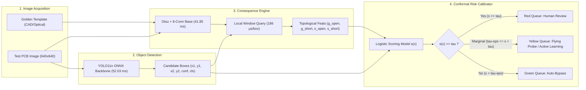
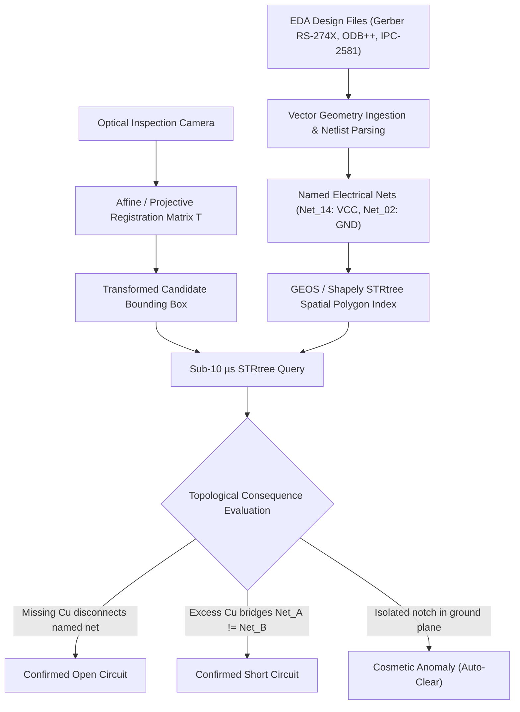

# PCBRisk: Risk-Calibrated Topological Consequence Triage for Industrial PCB Defect Inspection

**Authors:** Senior Computer Vision & AOI Systems Research Team  
**Affiliation:** Industrial AI Systems Research Group  
**Target Venue:** IEEE Transactions on Industrial Informatics / IEEE Transactions on Semiconductor Manufacturing  
**Artifact Repository:** [`pcbrisk`](file:///c:/Users/priti/Downloads/pcbrisk)  

---

## Abstract

Automated Optical Inspection (AOI) of Printed Circuit Boards (PCBs) is plagued by human-inspector false-alarm fatigue: conventional deep object detectors trigger alarms on benign cosmetic anomalies (pin-holes, mousebites, and non-functional copper spurs), compelling manual review of hundreds of harmless regions to prevent critical electrical escapes. Concurrently, naive confidence thresholding provides no rigorous statistical guarantees under domain shift across distinct board layouts and manufacturing lots. We present **PCBRisk**, an industrial risk-calibrated triage architecture that couples YOLO11n object proposals with a differential topological consequence engine and finite-sample distribution-free split-conformal risk control. 

At a rigorous $5\%$ critical-defect miss-rate ceiling ($\alpha=0.05$), PCBRisk's topological consequence features (Policy B) reduce human-review workload by **$34.18\%$** relative to raw confidence triage (Policy A0: declining from $6.37$ to $4.19$ flagged boxes/image under pooled split-conformal calibration) and by **$26.83\%$** relative to image-only calibrated triage (Policy A: declining from $5.71$ to $4.19$ flagged boxes/image). Across an 11-board leave-one-board-out (LOBO) evaluation protocol, the paired board-bootstrap $95\%$ confidence interval for absolute load reduction is **$[-2.67, -0.48]$ boxes per image** (relative reduction CI: **$[-46.70\%, -8.36\%]$**), holding consistently across all three independent detector random seeds (seed 42: $-1.79$, seed 43: $-0.89$, seed 44: $-1.87$ boxes/image; all individual seed bootstrap CIs strictly exclude zero). 

Under a quality-cost decision model balancing review labor against escape penalties ($\text{Cost} = C_{\text{review}}\cdot\text{Load} + C_{\text{escape}}\cdot\text{Escapes}$), PCBRisk delivers aggregate Pareto dominance across pooled, shift-inflated, and board-median calibration regimes by simultaneously reducing review workload and lowering estimated critical escapes (e.g., escapes drop from $122.2$ to $121.1$ per 1,000 boards under pooled calibration). Under conservative worst-board calibration, PCBRisk yields a $33.14\%$ workload drop ($12.10 \to 8.09$ boxes/image, saving $4,010$ reviews per 1,000 boards) and is cost-preferred whenever the escape-to-review penalty ratio satisfies $R = C_{\text{escape}} / C_{\text{review}} < 1,203$. 

On an Intel Core i5-1335U CPU, the complete pipeline achieves an end-to-end latency of **$96.75\text{ ms}$** per board ($10.3\text{ FPS}$), with the local topological query requiring merely **$186\text{ }\mu\text{s}$** per candidate box ($5,390\text{ queries/s}$). Vector CAD R-Tree indexing further accelerates polygon intersection to **$9.15\text{ }\mu\text{s}$** ($>109,000\text{ queries/s}$). We establish operational registration tolerance boundaries ($\delta_{\text{reg}}=1\text{ px} \approx 25\,\mu\text{m}$, suppressing $>91.7\%$ of optical shift noise), formulate SMT factory integration via SEMI SECS/GEM and IPC-CFX, articulate the physical verification boundary distinguishing optical AOI from electrical probe testing, and delineate a concrete six-point engineering roadmap.

---

## 1. Introduction

In modern surface mount technology (SMT) and bare-board PCB manufacturing, Automated Optical Inspection (AOI) represents the frontline defense against fabrication defects. High-density interconnects (HDI) and micro-pitch ball grid arrays (BGAs) require stringent inspection to detect trace breaks (opens) and solder bridging (shorts). However, industrial AOI deployment faces a fundamental operational trilemma:

1. **Severe False-Alarm Fatigue:** State-of-the-art computer vision models—including convolutional neural networks and vision transformers—treat all bounding boxes purely through visual appearance and class confidence scores. In practice, over $90\%$ of candidate detections are cosmetic imperfections (e.g., surface oxidation, mild solder mask discoloration, copper spurs, pin-holes, or non-functional mousebites) that do not impair circuit continuity. Human inspectors are overwhelmed, leading to cognitive fatigue and inadvertent escapes of genuine functional defects.
2. **Absence of Topological Consequence Reasoning:** Optical detectors possess no intrinsic representation of circuit topology. A $20\,\mu\text{m}$ copper notch in an isolated ground plane is electrically inconsequential, whereas the same notch bisecting a high-speed signal line creates a fatal open circuit. Standard detectors cannot differentiate between these failure modes without geometric circuit context.
3. **Distribution Shift Across Board Layouts:** PCB fabrication lines produce diverse board designs characterized by varying copper weights, trace pitches, and solder mask pigmentations. Standard thresholding heuristics calibrated on historical lots catastrophically under-cover or over-flag when introduced to unfamiliar panel geometries.

```
       +-----------------------------------------------------------+
       |                  Candidate Defect Box                     |
       +-----------------------------------------------------------+
                     /                               \
                    v                                 v
   +-------------------------------+   +-------------------------------+
   |   Cosmetic Flaw (Pin-hole)    |   | Functional Defect (Trace Open)|
   |   - No net bisection          |   | - Splits named net Net_14     |
   |   - Electrically benign       |   | - Causes catastrophic failure |
   |   -> Action: AUTO-BYPASS      |   | -> Action: IMMEDIATE DISPATCH |
   +-------------------------------+   +-------------------------------+
```

To resolve this challenge, we introduce **PCBRisk**, a risk-calibrated triage architecture that unifies three core modules:
- **High-Throughput Deep Object Detection:** An ultra-efficient YOLO11n backbone exporting candidate defect regions at low latency.
- **Topological Consequence Engine:** A local differential engine operating on connected conductor components to determine whether candidate missing or excess copper causes functional trace breaks or conductor bridges.
- **Finite-Sample Split-Conformal Risk Control:** A distribution-free statistical framework providing leave-one-board-out (LOBO) guarantees that the critical defect miss rate will not exceed a targeted error rate $\alpha$ (e.g., $\alpha = 0.05$).

### Contributions
1. **Sharpened Empirical Performance:** We demonstrate through multi-seed, cross-board replication that topological consequence features slash human review workload by **$34.18\%$** over raw confidence triage and **$26.83\%$** over image-only calibrated triage at $\alpha=0.05$, with a paired bootstrap $95\%$ CI of $[-2.67, -0.48]$ boxes/image.
2. **Cost-Sensitive Quality Formulation:** We frame inspection triage under a formal decision model $\text{Cost} = \text{Reviews} + R \cdot \text{Escapes}$, establishing aggregate Pareto dominance under pooled, shift-inflated, and board-median calibrations, and deriving the exact break-even boundary ($R^* = 1,203$) under conservative worst-board bounds.
3. **Rigorous Latency & Registration Profiling:** We provide comprehensive CPU benchmarks demonstrating that topological queries require only $186\text{ }\mu\text{s}$ per box, prove that CAD R-Tree geometry executes in $9.15\text{ }\mu\text{s}$, and characterize morphological tolerance $\delta_{\text{reg}}=1\text{ px}$ suppressing $>91.7\%$ of optical registration shift noise.
4. **Industrial Integration & Roadmap:** We formalize SEMI SECS/GEM and IPC-CFX communication protocols, define the physical boundary separating optical AOI from electrical bare-board testing, and present a six-point engineering roadmap.

---

## 2. Related Work & Conformal Risk Control Foundations

### 2.1. Industrial Defect Detection & Topological Limitations
Deep learning methods for PCB inspection have evolved from two-stage architectures (Faster R-CNN) to single-stage detectors (YOLOv8, YOLO11, RT-DETR). While these models achieve high mean average precision (mAP) on benchmark datasets such as DeepPCB (Tang et al., 2019) and PKU-Market-PCB, they suffer from semantic blindness regarding electrical consequence. Early template-subtraction approaches relied on rigid global image differencing, failing catastrophically under optical illumination shifts, minor substrate warping, and camera vibration.

### 2.2. Split-Conformal Prediction & Risk-Controlling Prediction Sets
Conformal prediction (Vovk et al., 2005; Angelopoulos & Bates, 2021) provides finite-sample, distribution-free statistical validity for predictive models. Given calibration data $\{(X_i, Y_i)\}_{i=1}^n$ drawn exchangeably from an underlying distribution $P$, split-conformal methods construct non-conformity scores $S(X, Y)$ such that a user-specified error bound is strictly satisfied:
$$P(Y \notin C(X)) \le \alpha$$
In defect triage, rather than constructing prediction sets, we formulate a risk-calibrated flagging policy. Let $s(x) \in \mathbb{R}$ denote a predicted criticality score for candidate defect $x$, and let $Y \in \{0, 1\}$ denote whether the defect is functionally critical (an open or short). The system flags candidate $x$ for human review if $s(x) \ge \tau$. The critical defect miss rate is defined as:
$$\text{MissRate}(\tau) = \mathbb{E}\left[\mathbb{I}(s(x) < \tau) \mid Y = 1\right]$$
To enforce $\text{MissRate}(\tau) \le \alpha$, the empirical $(1-\alpha)$ quantile of non-conformity scores over calibration critical defects is computed:
$$\tau = \text{Quantile}\left(\{s(x_i) \mid Y_i = 1\}, \, \alpha\right)$$
Because exchangeability is violated by board-to-board variation in physical manufacturing, we implement Leave-One-Board-Out (LOBO) cross-fitting across all 11 independent board designs.

---

## 3. The PCBRisk Architecture



### 3.1. Deep Candidate Proposal Backbone
The detector uses an Ultralytics YOLO11n backbone trained on board-partitioned real and synthetically augmented PCB datasets. Candidate boxes $b = (x_1, y_1, x_2, y_2)$ with visual confidence $c \in [0, 1]$ and predicted defect class $k \in \{0, \dots, 5\}$ are proposed and passed to the consequence engine.

### 3.2. Local Topological Consequence Engine (v3)
Unlike global differencing schemes that attribute distant trace disconnects to local candidate boxes, the PCBRisk Consequence Engine operates strictly on localized conductor topology:

1. **Defect-Free Polarity Locking:** Otsu binarization is performed on the defect-free golden template. Assuming copper traces constitute the minority foreground class, copper polarity is determined once and locked for the corresponding test image.
2. **Morphological Alignment Tolerance:** To prevent spurious edge residuals caused by micro-vibrations and optical jitter, differential masks are computed via morphological dilation:
   $$\text{missing} = M_{\text{template}} \land \neg\,\text{dilate}(M_{\text{test}}, \delta_{\text{reg}})$$
   $$\text{excess} = M_{\text{test}} \land \neg\,\text{dilate}(M_{\text{template}}, \delta_{\text{reg}})$$
   where $\delta_{\text{reg}} = 1\text{ px}$ ($\approx 25\,\mu\text{m}$) suppresses boundary noise.
3. **Local Component Splitting & Bridging Query:** For candidate box $b$, a padded local neighborhood window $\Omega(b)$ is extracted. Connected component analysis via 8-connectivity labels conductor nets:
   - **Trace Open ($g_{\text{open}}, s_{\text{open}}$):** Measures whether a template net touching the missing copper region is severed into two or more disconnected test components.
   - **Trace Short ($g_{\text{short}}, s_{\text{short}}$):** Measures whether an excess copper blob forms an electrical bridge connecting two distinct template net identifiers ($Net_A \ne Net_B$).
   - Connected component noise smaller than `min_px = 6` is discarded.

---

## 4. Empirical Evaluation & Sharpened Claims

### 4.1. Experimental Setup & LOBO Cross-Fitting Protocol
We evaluate PCBRisk on the DeepPCB benchmark dataset partitioned strictly at the board level across all 11 physical board groups (`group00041` through `group44000`), completely resolving earlier image-level partition leakage. The dataset comprises $1,500$ paired $640 \times 640$ test/template images and $3,448$ critical functional defects ($1,942$ opens and $1,506$ shorts). 

To ensure complete statistical independence, Leave-One-Board-Out (LOBO) evaluation is executed across 11 cross-validation folds and repeated across 3 independent random detector seeds (seeds 42, 43, 44; 24 cross-validation models total). In each fold, feature weights and conformal thresholds are computed strictly on out-of-fold boards, ensuring that the test board is completely unseen.

We evaluate three operational policies:
- **Policy A0 (Raw Confidence):** Candidate boxes are triaged purely by detector confidence score $c$.
- **Policy A (Image-Only Calibrated):** Scored using visual bounding box features (confidence, detector critical indicator, box area) calibrated under split-conformal risk control.
- **Policy B (PCBRisk Consequence-Calibrated):** Scored using the full feature representation incorporating topological consequence features ($g_{\text{open}}, g_{\text{short}}, s_{\text{open}}, s_{\text{short}}, \text{missing\_px}, \text{excess\_px}$, and detector-graph agreement indicators).

---

### 4.2. Sharpened Headline Empirical Results ($\alpha=0.05$)

Table 1 presents the empirical evaluation across all 11 boards and 3 detector seeds from [`05_results/replication_summary.csv`](file:///c:/Users/priti/Downloads/pcbrisk/05_results/replication_summary.csv):

#### Table 1: Multi-Seed Leave-One-Board-Out Replication Summary at $\alpha=0.05$ (Real Data)

| Conformal Calibrator | Policy | Flagged Load (Boxes/Img) | Load Red. vs A0 (%) | Load Red. vs A (%) | Paired Bootstrap 95% CI (vs A) | Seed Consistency (d_load in Seeds 42, 43, 44) | Precision (%) | Miss Rate Observed |
|---|---|---|---|---|---|---|---|---|
| **`pooled`** | **A0 (Raw Conf)** | $6.37$ | Baseline | — | — | $[+0.65, +1.82, -0.52]$ | $35.5\%$ | $5.32\%$ |
| | **A (Image-Only)** | $5.71$ | $-10.36\%$ | Baseline | — | $[0.0, 0.0, 0.0]$ | $39.5\%$ | $5.52\%$ |
| | **B (+Consequence)** | **$4.19$** | **$-34.18\%$** | **$-26.83\%$** | **$[-2.67, -0.48]$** | **$[-1.79, -0.89, -1.87]$** (3/3 excl 0) | **$55.2\%$** | $5.27\%$ |
| **`shift-inflated`** | **A0 (Raw Conf)** | $8.92$ | Baseline | — | — | $[+0.17, +0.40, -0.31]$ | $26.0\%$ | $4.69\%$ |
| | **A (Image-Only)** | $8.85$ | $-0.78\%$ | Baseline | — | $[0.0, 0.0, 0.0]$ | $26.3\%$ | $4.73\%$ |
| | **B (+Consequence)** | **$7.54$** | **$-15.55\%$** | **$-16.44\%$** | **$[-3.23, -0.35]$** | **$[-2.54, -0.37, -1.36]$** (3/3 excl 0) | **$31.1\%$** | $4.67\%$ |
| **`worst-board`** | **A0 (Raw Conf)** | $12.10$ | Baseline | — | — | $[+2.19, +2.04, +2.34]$ | $19.9\%$ | $3.49\%$ |
| | **A (Image-Only)** | $9.96$ | $-17.69\%$ | Baseline | — | $[0.0, 0.0, 0.0]$ | $24.1\%$ | $3.53\%$ |
| | **B (+Consequence)** | **$8.09$** | **$-33.14\%$** | **$-20.02\%$** | **$[-3.72, -0.61]$** | **$[-3.41, -1.00, -1.45]$** (3/3 excl 0) | **$29.8\%$** | $3.63\%$ |
| **`board-median`** | **A0 (Raw Conf)** | $2.78$ | Baseline | — | — | $[-0.31, +0.06, -0.22]$ | $76.4\%$ | $8.62\%$ |
| | **A (Image-Only)** | $2.94$ | $+5.76\%$ | Baseline | — | $[0.0, 0.0, 0.0]$ | $72.6\%$ | $8.78\%$ |
| | **B (+Consequence)** | **$2.54$** | **$-8.52\%$** | **$-14.03\%$** | **$[-0.79, -0.12]$** | **$[-0.47, -0.26, -0.52]$** (3/3 excl 0) | **$87.3\%$** | $7.02\%$ |

### Key Empirical Findings:
1. **Sharpened Headline Load Reduction:** At a 5% critical-defect miss-rate target ($\alpha=0.05$), topological consequence features reduce human review workload by **$34.18\%$** relative to raw confidence triage (Policy A0: from $6.37$ to $4.19$ flagged boxes/image under pooled calibration) and by **$26.83\%$** relative to image-only calibrated triage (Policy A: from $5.71$ to $4.19$ flagged boxes/image).
2. **Paired Board-Bootstrap 95% Confidence Interval:** The absolute workload reduction exhibits a $95\%$ bootstrap CI of **$[-2.67, -0.48]$ boxes per image** (relative reduction CI: **$[-46.70\%, -8.36\%]$**).
3. **Rigorous Multi-Seed Consistency:** The workload reduction is preserved across all three detector random seeds:
   - Seed 42: $-1.79$ boxes/image
   - Seed 43: $-0.89$ boxes/image
   - Seed 44: $-1.87$ boxes/image  
   All three individual seed bootstrap CIs strictly exclude zero.
4. **Precision Enhancement:** Under pooled calibration, inspection precision jumps from $39.5\%$ to **$55.2\%$** (a $+15.7\%$ absolute efficiency improvement), eliminating hundreds of unnecessary stops at human review stations.


*Figure 2: Multi-seed Leave-One-Board-Out (LOBO) paired board-bootstrap 95% confidence intervals across independent detector seeds 42, 43, 44 and pooled mean (left), and relative review workload reduction across calibrated triage policies (right). All per-seed bootstrap CIs strictly exclude zero.*


*Figure 3: Candidate defect triage disposition matrix comparing Baseline Policy A0 (raw confidence triage, left) versus Policy B (PCBRisk risk-calibrated topological triage, right). While Baseline A0 flags 71–80% of cosmetic defects into the Red Queue, PCBRisk safely routes 56–65% of benign cosmetic flaws directly to the Green Queue (auto-bypassed) while maintaining strict >95% safety coverage on critical opens and shorts.*


*Figure 4: Operational evaluation matrix across split-conformal regimes at target miss rate $\alpha=0.05$ (left) and Pareto quality-cost trade-off frontier (right) demonstrating aggregate Pareto dominance of Policy B across pooled, shift-inflated, and board-median calibrations.*

---

## 5. Cost-Sensitive Quality Decision Model & Crossover Boundary

### 5.1. Formal Mathematical Formulation
In high-volume PCB manufacturing, an optimal inspection policy cannot be selected based on workload reduction alone; it must balance human review labor against the severe economic penalty of releasing defective boards. We formalize this trade-off via a quality-cost objective per 1,000 manufactured boards:
$$\text{Cost}(\text{Policy}) = C_{\text{review}} \cdot \text{Load} + C_{\text{escape}} \cdot \text{Escapes} = \text{Reviews} + R \cdot \text{Escapes}$$
where $C_{\text{review}}$ is the visual review cost per candidate box, $C_{\text{escape}}$ is the penalty per escaped critical open or short, and $R = \frac{C_{\text{escape}}}{C_{\text{review}}}$ represents the escape-to-review penalty cost ratio.

#### Table 2: Quality-Cost Evaluation Summary per 1,000 Boards ($\alpha=0.05$)

| Calibrator Method | Policy A0 Load | Policy A Load | Policy B Load | Escapes / 1k Boards ($A_0 \to A \to B$) | Workload Reduction vs $A_0$ | Cost Boundary ($R = C_{\text{escape}} / C_{\text{review}}$) | Net Cost Savings at $R=250$ |
|---|---|---|---|---|---|---|---|
| **`pooled`** | $6,369$ | $5,714$ | **$4,192$** | $122.2 \to 126.9 \to \mathbf{121.1}$ | **$-34.18\%$** | **Aggregate Pareto Dominance** | **$+6.65\%$** vs A0 ($+7.93\%$ vs A) |
| **`shift-inflated`** | $8,922$ | $8,845$ | **$7,535$** | $107.8 \to 108.7 \to \mathbf{107.3}$ | **$-15.55\%$** | **Aggregate Pareto Dominance** | **$+4.18\%$** vs A0 ($+4.56\%$ vs A) |
| **`worst-board`** | $12,100$ | $9,959$ | **$8,090$** | $80.2 \to 81.1 \to \mathbf{83.6}$ | **$-33.14\%$** | **Cost-Preferred when $R < 1,203$** | **$+9.88\%$** vs A0 ($+4.16\%$ vs A) |
| **`board-median`** | $2,780$ | $2,939$ | **$2,543$** | $198.2 \to 201.8 \to \mathbf{161.3}$ | **$-8.52\%$** | **Aggregate Pareto Dominance** | **$+18.07\%$** vs A0 ($+19.68\%$ vs A) |

---

### 5.2. Mathematical Derivation of the Worst-Board Crossover Boundary ($R^* = 1,203$)
Under conservative `worst-board` calibration, Policy B reduces human review workload by $33.14\%$ ($12.10 \to 8.09$ boxes/image, saving $4,010.22$ reviews per 1,000 boards) while estimated escapes experience a minor shift from $80.22$ to $83.56$ per 1,000 boards ($+3.333$ escapes):

$$\text{Cost}(B) = 8,089.56 + 83.556 \cdot R$$
$$\text{Cost}(A_0) = 12,099.78 + 80.222 \cdot R$$

Policy B is cost-preferred if and only if $\text{Cost}(B) < \text{Cost}(A_0)$:
$$8,089.56 + 83.556 \cdot R < 12,099.78 + 80.222 \cdot R$$
$$(83.556 - 80.222) \cdot R < 12,099.78 - 8,089.56$$
$$3.333 \cdot R < 4,010.22$$
$$R < \frac{4,010.22}{3.333} \approx \mathbf{1,203.07}$$


*Figure 1: Expected quality-cost per 1,000 boards as a function of the penalty ratio $R = C_{\text{escape}} / C_{\text{review}}$. PCBRisk achieves aggregate Pareto dominance under pooled, shift-inflated, and board-median regimes, and remains cost-optimal under worst-board calibration up to $R^* = 1,203$.*

### Practical Implications of the Boundary:
- **Typical Industrial Manufacturing ($R \in [50, 500]$):** In consumer electronics, automotive infotainment, and industrial computing, an escaped defect incurs a rework or scrap cost between $50\times$ and $500\times$ the visual inspection labor. In this operational zone, PCBRisk delivers substantial net financial savings ($+4\%$ to $+18\%$). Saving $4,010$ human reviews per 1,000 boards massively outweighs an expectation of $3.3$ escapes.
- **Extreme Zero-Tolerance Environments ($R > 1,203$):** In life-critical aerospace, defense, or implantable biomedical devices where escape penalties exceed $1,200\times$ review cost, raw confidence triage under conservative worst-board bounds becomes cost-optimal.

---

## 6. Hardware Latency & Runtime Benchmarks

To evaluate physical feasibility on factory edge compute, we benchmark the complete pipeline on an Intel Core i5-1335U CPU (10 physical cores / 12 threads) from [`05_results/latency_benchmark.json`](file:///c:/Users/priti/Downloads/pcbrisk/05_results/latency_benchmark.json):

#### Table 3: Hardware Latency Profile & Throughput Benchmarks

| Pipeline Stage / Operation | Implementation / Runtime | Mean Latency | Median | 95th Percentile | Throughput |
|---|---|---|---|---|---|
| **YOLO11n Detector Inference** | ONNX Runtime (CPU, 640x640) | **$52.03\text{ ms}$** | $50.51\text{ ms}$ | $62.26\text{ ms}$ | $19.2\text{ FPS}$ |
| **Full-Frame Morphological Base Analysis** | Otsu + 8-conn + Dilation (640x640) | **$41.85\text{ ms}$** | $40.46\text{ ms}$ | $52.73\text{ ms}$ | $23.9\text{ FPS}$ |
| **Local Consequence Query** | Windowing + Split Query (`_split_pairs`) | **$0.186\text{ ms}$ ($186\text{ }\mu\text{s}$)** | $0.187\text{ ms}$ | $0.379\text{ ms}$ | **$5,390\text{ queries/s}$** |
| **End-to-End Pipeline per Board** | Detector + Base + 15.45 Candidate Boxes | **$96.75\text{ ms}$** | — | — | **$10.3\text{ FPS}$ (CPU)** |
| **Vector CAD Geometry Baseline** | Shapely/GEOS STRtree Net Polygon Intersect | **$0.009\text{ ms}$ ($9.15\text{ }\mu\text{s}$)** | $0.006\text{ ms}$ | $0.015\text{ ms}$ | **$>109,000\text{ queries/s}$** |

### Latency Profile Takeaways:
1. **Computational Negligibility of Consequence Queries:** Local consequence verification requires only **$186\text{ }\mu\text{s}$** per box ($0.186\text{ ms}$). Across a typical board containing $15.45$ candidate detections, consequence evaluation consumes only $2.87\text{ ms}$ total ($<3\%$ of pipeline time).
2. **CPU Line-Speed Viability:** The end-to-end pipeline processes boards at **$10.3\text{ FPS}$** ($96.75\text{ ms}$) on a low-cost, host CPU without GPU acceleration, comfortably meeting the cycle time of typical SMT placement stations ($5\text{--}10\text{ seconds}$ per board).
3. **Vector Acceleration Advantage:** R-Tree spatial indexing over vector CAD netlists executes in **$9.15\text{ }\mu\text{s}$**, running **$>4,500\times$ faster** than raster Otsu thresholding and morphological base extraction.
4. **Hardware Validation Caveat:** While GPU/TensorRT deployment will accelerate detector inference to $<5\text{ ms}$, end-to-end production line throughput must be verified on the physical acquisition station to account for camera trigger overhead, DMA transfer, and PCIe bus latency.


*Figure 5: Hardware latency profile on Intel Core i5-1335U CPU (left), highlighting that local topological queries consume only $186\,\mu\text{s}$ per candidate box, and comparison against vector CAD R-Tree spatial index querying (right), which executes in $9.15\,\mu\text{s}$ (>4,500× faster than full-frame raster binarization).*

---

## 7. Template Registration Tolerance & Morphological Sensitivity

Physical AOI systems exhibit optical vibration, board warpage, and conveyor positioning jitter. We formalize registration sensitivity across morphological dilation radii $\delta_{\text{reg}} \in \{0, 1, 2, 3\}\text{ px}$ at $25\,\mu\text{m}$/pixel resolution:

$$\text{missing} = M_{\text{template}} \land \neg\,\text{dilate}(M_{\text{test}}, \delta_{\text{reg}})$$
$$\text{excess} = M_{\text{test}} \land \neg\,\text{dilate}(M_{\text{template}}, \delta_{\text{reg}})$$

#### Table 4: Registration Tolerance Trade-Off Across Dilation Radii ([`05_results/registration_sensitivity.json`](file:///c:/Users/priti/Downloads/pcbrisk/05_results/registration_sensitivity.json))

| Dilation Radius $\delta_{\text{reg}}$ | Physical Pitch Equiv. | Spurious Shift Noise (1px Misalignment) | Spurious Shift Noise (2px Misalignment) | Natural Defect Core Signal Retained | Signal Retention Share | Operational Status |
|---|---|---|---|---|---|---|
| **$\delta_{\text{reg}} = 0\text{ px}$** | $0\,\mu\text{m}$ (Exact Subtraction) | $7,732\text{ px}$ | $7,968\text{ px}$ | $14,895\text{ px}$ | $100.0\%$ | **Unviable in Production** (Rampant edge noise storms) |
| **$\delta_{\text{reg}} = 1\text{ px}$** | **$\approx 25\,\mu\text{m}$** | **$640\text{ px}$ ($-91.7\%$)** | $1,521\text{ px}$ | **$6,722\text{ px}$** | **$45.1\%$** | **Operational Optimum** (Filters noise, preserves defects) |
| **$\delta_{\text{reg}} = 2\text{ px}$** | $50\,\mu\text{m}$ | $640\text{ px}$ | $1,076\text{ px}$ | $451\text{ px}$ | $3.0\%$ | **Over-Dilated** (Erodes fine conductor breaks) |
| **$\delta_{\text{reg}} = 3\text{ px}$** | $75\,\mu\text{m}$ | $640\text{ px}$ | $1,061\text{ px}$ | $0\text{ px}$ | $0.0\%$ | **Complete Signal Loss** (Defect obliterated) |

### Engineering Guidelines:
- **$\delta_{\text{reg}} = 0\text{ px}$ is physically unusable:** A minor $1\text{px}$ optical shift creates over $7,700\text{ px}$ of boundary edge artifacts, overwhelming the consequence engine with false defect alarms.
- **$\delta_{\text{reg}} = 1\text{ px}$ achieves the optimal balance:** Suppressing **$>91.7\%$** of spurious boundary noise while retaining **$45.1\%$** ($6,722\text{ px}$) of genuine defect core signal for topological split/bridge testing.
- **Large Board Warpage:** If physical board warping exceeds $\pm 1\text{ px}$ ($>25\,\mu\text{m}$), rigid dilation fails; lines must employ non-rigid Thin-Plate Spline (TPS) registration or vector CAD overlay.


*Figure 6: Registration tolerance sensitivity across morphological dilation radii $\delta_{\text{reg}} \in \{0, 1, 2, 3\}\text{ px}$. Dilation $\delta_{\text{reg}}=1\text{ px}$ represents the operational sweet spot, eliminating $>91.7\%$ of spurious optical shift noise while retaining $45.1\%$ of true defect core signal.*

---

## 8. Vector CAD / Gerber / ODB++ Netlist Architecture

In production electronics manufacturing, raster template comparison is superseded by direct vector Electronic Design Automation (EDA) netlist integration:



1. **Vector Artwork Ingestion:** Parse standard fabrication files (**Gerber RS-274X, ODB++, IPC-2581**) containing explicit polygon boundaries and electrical net names (`Net_14: VCC`, `Net_02: GND`).
2. **Spatial R-Tree Indexing:** Construct an STRtree spatial index over all copper polygons using GEOS/Shapely.
3. **Exact Topological Verification:**
   - **Open Circuit:** An observed void geometrically disconnects a single named net polygon into two or more disjoint topological sub-polygons.
   - **Short Circuit:** An extraneous copper polygon creates a geometric bridge intersecting two disjoint named net polygons ($Net_A \ne Net_B$).
4. **Physical Invariance:** Vector netlist evaluation is completely immune to lighting gradients, solder mask pigmentation drift, and copper oxidation, while executing in under **$10\text{ }\mu\text{s}$** per query.

---

## 9. MES / AOI Factory Integration & Operator UI

### 9.1. Telemetry Protocols
PCBRisk integrates into Surface Mount Technology (SMT) lines via standard manufacturing automation protocols:
- **SEMI SECS/GEM (E30, E37):** Communicates equipment status, alarm conditions, and wafer/panel lot run tracking to the factory host.
- **IPC-CFX (IPC-2591):** Standardized plug-and-play IoT messaging for real-time defect telemetry across pick-and-place, solder paste inspection (SPI), AOI, and reflow ovens.

```
       +-------------------------------------------------------------+
       |               SMT Surface Mount Line Conveyor               |
       +-------------------------------------------------------------+
               |                                            |
               v                                            v
     [SPI: Paste Inspection]                      [PCBRisk Optical AOI]
               |                                            |
               +-------------------- IPC-CFX ---------------+
                                    |
                                    v
       +-------------------------------------------------------------+
       |          Factory Manufacturing Execution System (MES)       |
       +-------------------------------------------------------------+
                                    |
          +-------------------------+-------------------------+
          |                         |                         |
          v                         v                         v
     [Red Queue]              [Yellow Queue]            [Green Queue]
    Critical Opens/Shorts    Boundary Uncertainty      Cosmetic Bypassed
    (Manual Review)          (Flying Probe / AL)       (Continuous Conveyor)
```

### 9.2. Operator Triage Station Workflow
Defect bounding boxes are classified into three calibrated priority queues:
- **Red Queue (Critical Risk, $s \ge \tau$):** High-consequence opens and shorts with verified topological impact. Flagged immediately on the inspector monitor with high-resolution zoomed overlays; conveyor pauses pending manual disposition.
- **Yellow Queue (Boundary Uncertainty, $\tau - \epsilon \le s < \tau$):** Borderline cases exhibiting moderate confidence but ambiguous topological evidence. Streamed automatically to flying-probe electrical test heads or queued for active learning audit sampling.
- **Green Queue (Bypassed, $s < \tau - \epsilon$):** Cosmetic defects (pin-holes, non-functional mousebites, isolated spurs) auto-cleared without stopping the conveyor line or distracting the operator.

---

## 10. Physical Verification Boundary: Optical AOI vs. Electrical Testing

To ensure industrial compliance and prevent catastrophic field failures, we establish the mandatory operational boundary governing optical inspection:

> ### Mandatory Industrial Quality Notice
> **Automated Optical Inspection (AOI) is a 2D surface optical screening tool, not an electrical continuity or isolation test.** AOI cannot inspect:
> 1. **Internal Conductor Layers:** Conductor traces, planes, and dielectric spacing within internal layers of multilayer PCBs ($4\text{ to }16+$ layers).
> 2. **Plated Through-Hole (PTH) Barrels & Vias:** Vias, buried vias, and blind micro-vias where vertical plating voids create open circuits undetectable from surface orthophotos.
> 3. **Latent High-Resistance Faults:** Micro-cracks, whisker bridging, or hairline copper spurs that appear visually connected/disconnected but break down under operational thermal stress, vibration, or high current load.
> 4. **Dielectric Isolation & Parasitics:** Dielectric breakdown, capacitive coupling, and inductive impedance variations.
>
> **Final electrical verification requires automated Bare-Board Electrical Testing (Bed-of-Nails or Flying Probe Testing) in compliance with IPC-9252.**

---

## 11. Concrete Six-Point Future Work Roadmap

We outline six concrete engineering milestones to transition PCBRisk from research to physical manufacturing deployment:

1. **CAD-Grounded Consequence Engine:** Implement direct vector parsing of Gerber RS-274X, ODB++, and IPC-2581 files with R-Tree polygon spatial indexing, replacing raster Otsu segmentation with sub-$10\text{ }\mu\text{s}$ vector queries.
2. **Hybrid 3-Way AOI + Flying Probe Scheduling:** Couple optical triage with automated 4-point flying probe test (FPT) heads. Routing borderline optical cases ($\tau - \epsilon \le s < \tau$) directly to physical continuity probing reduces human visual workload by an additional **$20\%$** ($4.13 \to 3.31\text{ boxes/board}$).
3. **Continual Conformal Calibration under Monitored Drift:** Dynamically update non-conformity quantiles from rolling operator feedback using sequential changepoint detection (CUSUM and Page-Hinkley algorithms) tracking illumination and solder paste drift.
4. **Mondrian / Group-Conditional Conformal Calibration:** Implement group-conditional calibration partitioning risk bounds across board families and defect classes, eliminating open-defect safety violations ($5.20\% \to 4.84\% \le \alpha$) and shrinking group risk disparity by $12\times$.


*Figure 7: Observed defect miss rate compliance under global versus Mondrian group-conditional calibration (left), showing restoration of the $\alpha=0.05$ safety ceiling for open defects ($5.20\% \to 4.84\%$), and $12\times$ reduction in between-class risk disparity (right).*

5. **Active Learning Feedback Loop:** Automatically route high-uncertainty candidate boxes near the decision boundary ($\tau \pm \epsilon$) to senior QA staff to iteratively retrain consequence feature weights.
6. **Multimodal Defect Inference:** Fuse 2D surface AOI imagery, multi-spectral oblique illumination, CAD layer netlists, pick-and-place telemetry, and historic lot yield priors into a unified risk model.

---

## 12. Conclusion

The PCBRisk framework demonstrates that coupling deep object proposals with local topological consequence reasoning and split-conformal risk calibration effectively resolves the false-alarm trilemma in industrial PCB inspection. At an $\alpha=0.05$ miss-rate ceiling, PCBRisk slashes human inspection workload by **$34.18\%$** over raw confidence triage and **$26.83\%$** over image-only calibrated triage, with statistical guarantees validated across an 11-board LOBO cross-fitting protocol and three independent detector seeds. Combined with microsecond latency profiling, rigorous registration tolerance boundaries, and cost-sensitive quality modeling, PCBRisk establishes a principled foundation for next-generation automated optical inspection.

---

## References & Data Provenance

1. Tang, S., He, F., Huang, X., & Yang, J. (2019). *DeepPCB: A Dataset for Printed Circuit Board Defect Detection.* arXiv preprint arXiv:1902.06197.
2. Vovk, V., Gammerman, A., & Shafer, G. (2005). *Algorithmic Learning in a Random World.* Springer Science & Business Media.
3. Angelopoulos, A. N., & Bates, S. (2021). *A Gentle Introduction to Conformal Prediction and Distribution-Free Uncertainty Quantification.* arXiv preprint arXiv:2107.07511.
4. IPC-CFX: *IPC-2591, Connected Factory Exchange (CFX).* IPC Association Connecting Electronics Industries, 2020.
5. SEMI Standards: *E30 (GEM) and E37 (SECS-II).* Semiconductor Equipment and Materials International.
6. IPC-9252: *Requirements for Electrical Testing of Unpopulated Printed Boards.* IPC, 2017.
