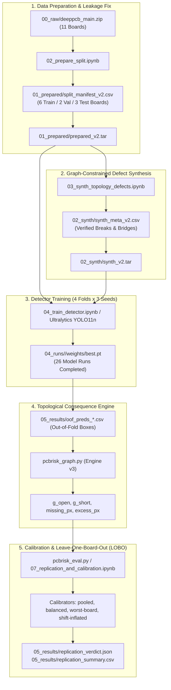

# Project Handover Documentation: PCBRisk

**Project Title:** Risk-Calibrated PCB Defect Inspection via Graph Consequence Verification  
**Repository:** `pcbrisk`  
**Date of Handover:** October 2026  
**Primary Tech Stack:** Python 3.10+, PyTorch, Ultralytics YOLO11, OpenCV, SciPy, Scikit-Image, Scikit-Learn, Google Colab / Google Drive  

---

## 1. Executive Summary

The **PCBRisk** framework addresses a critical limitation in industrial automated optical inspection (AOI) of printed circuit boards: **standard object detectors output bounding boxes and visual confidence scores, but cannot reason about the electrical/circuit consequence of defects**. 

In production lines, human review stations face severe false-alarm fatigue from cosmetic flaws (such as surface pin-holes, mousebites, or non-functional copper spurs), while missing subtle functional defects (trace breaks and bridges) can lead to catastrophic board failures.

PCBRisk solves this by coupling:
1. **Computer Vision Detection (YOLO11n):** Candidate defect bounding box proposal.
2. **Topological Graph Consequence Engine:** A localized differential net-connectivity engine comparing the test image to a golden template to determine whether missing or excess copper actually causes an electrical **open** or **short**.
3. **Distribution-Free Risk Control (Split-Conformal Prediction):** A statistical calibration framework with leave-one-board-out (LOBO) validation guaranteeing that the critical defect miss rate remains bounded at or below a user-specified threshold $\alpha$ (e.g., $5\%$ or $10\%$), while minimizing human inspection load (flagged boxes per image).

---

## 2. System Architecture & End-to-End Pipeline



---

## 3. The "Why": Critical Technical Decisions & Pivots

### 3.1. Pivot from v1 to v2: Eliminating Board-Level Leakage
* **What Happened in v1:** The official DeepPCB split partitioned images randomly across the entire dataset. Because each of the 11 PCB boards (`group00041` through `group44000`) has hundreds of crops, crops of the *exact same physical board* appeared in train, validation, and test splits. Models overfitted to board-specific trace layouts, lighting, and solder mask coloring.
* **The v2 Solution ([`02_prepare_split (1).ipynb`](file:///c:/Users/priti/Downloads/pcbrisk/02_prepare_split%20(1).ipynb)):** All 11 physical boards were strictly partitioned at the board level:
  * **Train (6 boards):** `group00041`, `group12000`, `group12100`, `group13000`, `group20085`, `group27000`
  * **Validation (2 boards):** `group12300`, `group22000`
  * **Test (3 boards):** `group20042`, `group20070`, `group44000`
  * Cross-validation folds $0$ to $3$ assign 2–3 entire boards per fold.
  * Broken v1 files were permanently isolated into [`99_archive/wrong_split_v1/`](file:///c:/Users/priti/Downloads/pcbrisk/99_archive/wrong_split_v1).

### 3.2. Evolution of the Consequence Engine (v2 $\rightarrow$ v3)
* **The Problem with Notebook 05 Engine:**
  1. Asked global questions ("Does this template net split *anywhere* in the image?"), falsely attributing distant trace disconnects to unrelated candidate boxes.
  2. Strict pixel subtraction suffered from registration drift / optical misalignment.
  3. Binarization polarity was calculated per image, leading to inverted masks when illumination varied.
* **The v3 Solution ([`code/pcbrisk_graph.py`](file:///c:/Users/priti/Downloads/pcbrisk/code/pcbrisk_graph.py)):**
  1. **Box-Local Evidence:** Only checks net-component pairs that touch the missing or excess copper inside and immediately adjacent to the bounding box.
  2. **Morphological Alignment Tolerance:** Computes:
     $$\text{missing} = M_{\text{template}} \land \neg\,\text{dilate}(M_{\text{test}}, \text{tol})$$
     $$\text{excess} = M_{\text{test}} \land \neg\,\text{dilate}(M_{\text{template}}, \text{tol})$$
  3. **Fixed Polarity:** Determines copper polarity once on the defect-free template (minority Otsu class) and reuses it for the test image.
  4. **Noise Thresholding:** Discards artifact blobs smaller than `min_px` (default $6$ px).

### 3.3. Conformal Calibration Under Board Shift
* Standard split-conformal prediction assumes exchangeability between calibration and test data. In manufacturing, test boards exhibit covariate shift (different trace geometries, manufacturing batch variances).
* **Calibrator Progression:**
  * **Pooled:** Pools calibration scores across all other boards. Under-covers under board shift (observed miss rate exceeds $\alpha$ by $\sim 1.18\times$).
  * **Worst-Board:** Chooses the strictest threshold across calibration boards ($\min_b \tau_b$). Over-covers and doubles the human inspection load.
  * **Shift-Inflated / Board-Median ([`07_replication_and_calibration (1).ipynb`](file:///c:/Users/priti/Downloads/pcbrisk/07_replication_and_calibration%20(1).ipynb)):** Estimates inflation factor $\lambda = \text{miss} / \alpha$ internally among calibration boards, targeting $\alpha / \lambda$. Achieves miss rate near $1.0\times \alpha$ with moderate inspection load.

### 3.4. The Reference-Free Student Head Failure
* **Hypothesis:** Can we train a small CNN on test-image crops alone to predict open/short/none, avoiding the need for a golden template at inference time?
* **Result (Checklist Item 4 in `verdict_report.json`):** **FAILED.**
* **Why:** Verifying whether a missing trace segment breaks circuit continuity requires knowing the global net topology. Without the reference template to confirm if an alternate electrical path exists, the CNN could not match the template-based consequence engine.

---

## 4. File-by-File Inventory & Explanation

### 4.1. Core Library Modules ([`code/`](file:///c:/Users/priti/Downloads/pcbrisk/code))

| File | Purpose & Implementation Details |
|---|---|
| [`pcbrisk_utils.py`](file:///c:/Users/priti/Downloads/pcbrisk/code/pcbrisk_utils.py) | **Environment & Storage Utilities:** Google Drive/Colab path resolution, deterministic seeding (`seed_all`), SHA-256 integrity verification, safe atomic file copies (`safe_copy`), compressed `.npz` caching, and high-speed tarball unpacking to local SSD (`restore_tar`). |
| [`pcbrisk_graph.py`](file:///c:/Users/priti/Downloads/pcbrisk/code/pcbrisk_graph.py) | **Topological Consequence Engine (v3):** Otsu binarization, morphological dilation tolerance, connected-component analysis via `scipy.ndimage`, localized trace splitting (`s_open`) and trace bridging (`s_short`) measurement. |
| [`pcbrisk_graph (1).py`](file:///c:/Users/priti/Downloads/pcbrisk/code/pcbrisk_graph%20(1).py) | Identical duplicate of `pcbrisk_graph.py` (verified by identical SHA-256 hash `F50AB23...`). Kept for backward compatibility. |
| [`pcbrisk_eval.py`](file:///c:/Users/priti/Downloads/pcbrisk/code/pcbrisk_eval.py) | **Evaluation & Calibration Engine:** Feature matrix engineering (`add_features`), logistic scoring model (`_fit`), conformal threshold policies (`tau_pooled`, `tau_weighted`, `tau_robust`), 11-board LOBO loop (`lobo`), paired bootstrap (`paired_bootstrap`), and calibration-free matched-miss benchmarking (`matched_miss`). |

---

### 4.2. Jupyter Notebooks

#### 1. [`01_datasets_to_drive (1).ipynb`](file:///c:/Users/priti/Downloads/pcbrisk/01_datasets_to_drive%20(1).ipynb)
* **Goal:** Download, verify, and store raw DeepPCB dataset into Google Drive once.
* **Actions:** Clones `tangsanli5201/DeepPCB`, zips clean files to `00_raw/deeppcb_main.zip`, computes SHA-256 (`5654be20...`), records attribution in `SOURCES.md`.
* **Runtime:** CPU only.

#### 2. [`02_prepare_split (1).ipynb`](file:///c:/Users/priti/Downloads/pcbrisk/02_prepare_split%20(1).ipynb)
* **Goal:** Convert DeepPCB annotations into YOLO format and create a board-level split.
* **Actions:** Reads 1,500 test images and annotations across 11 boards. Fixes leading-zero ID formatting (`image_id` string). Partitions 11 boards into 6 Train / 2 Val / 3 Test, assigns CV folds $0$–$3$. Emits `split_manifest_v2.csv`, `class_map.yaml`, `manifest_v2.sha256`, and packages `prepared_v2.tar`.
* **Runtime:** CPU only.

#### 3. [`03_synth_topology_defects (1).ipynb`](file:///c:/Users/priti/Downloads/pcbrisk/03_synth_topology_defects%20(1).ipynb)
* **Goal:** Synthesize realistic defects on defect-free templates with ground-truth topological consequence labels.
* **Actions:**
  * `op_break`: Cuts trace skeleton; only retains if connected component count increases (guaranteed open).
  * `op_bridge`: Adds copper bridge between distinct components with $3\text{--}14$ px gap; only retains if components merge (guaranteed short).
  * Emits 2,225 samples in `02_synth/synth_v2.tar` with full provenance in `synth_meta_v2.csv`.
* **Runtime:** CPU only.

#### 4. [`04_train_detector (1).ipynb`](file:///c:/Users/priti/Downloads/pcbrisk/04_train_detector%20(1).ipynb)
* **Goal:** Train YOLO11n object detectors across folds, seeds, and dataset variants.
* **Actions:** Uses Ultralytics YOLO11n (60 epochs, imgsz 640, batch 16). Contains live Drive mirroring (throttled to 120s) and crash-resume logic. Gated by `weights/best.pt` and logs test mAP50 / mAP50-95 into `master_results_v2.csv`.
* **Runtime:** GPU (T4 / V100 / A100).

#### 5. [`05_graph_consequence_eval (1).ipynb`](file:///c:/Users/priti/Downloads/pcbrisk/05_graph_consequence_eval%20(1).ipynb)
* **Goal:** Evaluate the consequence engine and pilot split-conformal flagging.
* **Actions:** Evaluates the consequence engine on known ground-truth boxes (Part A). Builds out-of-fold predictions and tests Policy A (image-only) vs Policy B (+graph features) across 4 folds at $\alpha \in \{0.02, 0.05, 0.10\}$ (Part B).
* **Runtime:** GPU for prediction generation; CPU for evaluation.

#### 6. [`06_auto_pipeline_(2).ipynb`](file:///c:/Users/priti/Downloads/pcbrisk/06_auto_pipeline_(2).ipynb)
* **Goal:** Autonomous pipeline execution with engine auto-tuning and CNN student head distillation.
* **Actions:** Tunes engine parameters on folds 0–1, validates on folds 2–3. Distills a reference-free CNN head from engine labels. Executes 11-board LOBO conformal flagging and outputs automated PASS/FAIL checks to `verdict_report.json`.
* **Runtime:** GPU (T4).

#### 7. [`07_replication_and_calibration (1).ipynb`](file:///c:/Users/priti/Downloads/pcbrisk/07_replication_and_calibration%20(1).ipynb)
* **Goal:** Full multi-seed replication and board-shift calibration refinement.
* **Actions:** Evaluates across **3 random seeds (42, 43, 44)** for both real and synthetic configurations (24 models total). Compares four conformal calibrators (`pooled`, `worst-board`, `board-median`, `shift-inflated`). Exports final statistical verdict to `replication_verdict.json` and `replication_summary.csv`.
* **Runtime:** GPU (T4).

---

### 4.3. Data, Runs & Results Directories

#### `00_raw/`
* `SOURCES.md`: License documentation (Tang et al. 2019, research use only).
* `checksums.txt`: SHA-256 verification hashes for archives.
* `deeppcb_main.zip`: Complete 91 MB archive of raw DeepPCB data.

#### `01_prepared/`
* `class_map.yaml`: Defect class dictionary: `0: open`, `1: short`, `2: mousebite`, `3: spur`, `4: copper`, `5: pin-hole`.
* `split_manifest_v2.csv`: Master manifest table (1,500 images, image IDs, source board names, split assignments, fold assignments, defect counts).
* `manifest_v2.sha256`: Checksum hash (`1f5bffd29c0d3b1e5cb6c9bc4c104da90fc646afc01c3e723118a54b65d5e9ce`).
* `prepared_v2.tar`: 52 MB archive containing all images and YOLO format txt labels.

#### `02_synth/`
* `synth_v2_config.json`: Configuration dictionary recording generation rules and parent manifest hash.
* `synth_meta_v2.csv`: Instance-level table for 2,225 synthetic defects (bounding boxes, op type, net IDs, gap width).
* `synth_v2.tar`: 136 MB archive containing synthetic image crops and YOLO labels.

#### `04_runs/` (26 Completed YOLO11n Model Directories)
Every run contains `args.yaml`, `results.csv`, `run_info.json`, `weights/best.pt`, `weights/last.pt`, and a `DONE` marker:
* `det_yolo11n_deeppcb_fixed_s42_v2`: Fixed split, real data only.
* `det_yolo11n_deeppcb+synth1_fixed_s42_v2`: Fixed split, real + synthetic data.
* `det_yolo11n_deeppcb_f{0..3}_s{42..44}_v2`: 12 models covering 4 folds across 3 seeds (real data).
* `det_yolo11n_deeppcb+synth1_f{0..3}_s{42..44}_v2`: 12 models covering 4 folds across 3 seeds (real + synthetic).

#### `05_results/`
* `master_results_v2.csv`: Summary of test mAP50 and mAP50-95 across all 26 training runs.
* `engine_v2_params.json`: Auto-tuned hyperparameters (`tol=1`, `sig=10`, `pad=2`, `minpx=2`) and held-out validation metrics.
* `engine_validation.csv` & `engine_v2_validation.csv`: Box-by-box comparison between annotated defect types and engine verdicts.
* `oof_preds_*.csv`: Out-of-fold candidate bounding boxes with detector confidence and coordinates across seeds.
* `lobo_*.csv` & `lobo_summary_*.csv`: Detailed per-board and summary metrics from Leave-One-Board-Out runs.
* `replication_summary.csv`: Seed-aggregated bootstrap comparisons between Policy A (image-only) and Policy B (+graph features).
* `replication_verdict.json`: Exact boolean verdicts per setting.
* `verdict_report.json`: Pipeline checklist validation output.

#### `99_archive/wrong_split_v1/`
Preserved historical artifacts from the flawed v1 split (contains `class_map.yaml`, `manifest_v1.sha256`, `prepared_v1.tar`, `split_manifest_v1.csv`, `synth_meta_v1.csv`, `synth_v1.tar`, `synth_v1_config.json`). Kept to document why v1 failed and avoid accidental re-execution.

---

## 5. Key Empirical Findings

### 5.1. Object Detector Performance ([`master_results_v2.csv`](file:///c:/Users/priti/Downloads/pcbrisk/05_results/master_results_v2.csv))
* **Fixed Split:** Real-only model achieved `test_map50_95 = 0.6951`. Adding synthetic defects (`+synth1`) boosted performance to `0.7443` (**$+4.92\%$ absolute improvement**).
* **Fold Variability:** Folds 1 and 2 consistently achieved mAP50 $>0.96$. Fold 0 (containing board `group00041`) is substantially more challenging (mAP50 $\approx 0.86\text{--}0.89$), highlighting the necessity of board-level cross-validation.

### 5.2. Consequence Engine Performance ([`engine_v2_params.json`](file:///c:/Users/priti/Downloads/pcbrisk/05_results/engine_v2_params.json))
On held-out boards:
* **Open Defect Identification:** $64.35\%$ strict accuracy.
* **Short Defect Identification:** $73.71\%$ strict accuracy.
* **Non-Critical False-Flag Rate:** **$1.17\%$** (cosmetic mousebites, spurs, and pin-holes were correctly disregarded $98.83\%$ of the time).

### 5.3. Conformal Inspection Load Reduction ([`replication_verdict.json`](file:///c:/Users/priti/Downloads/pcbrisk/05_results/replication_verdict.json))
The core experimental hypothesis was tested: *Does Policy B (+graph features) reduce the number of flagged boxes per image compared to Policy A (image-only) at the same guaranteed miss rate $\alpha$?*

| Setting | $\alpha$ | Calibrator | Hypothesis Verdict | Finding |
|---|---|---|---|---|
| **Real** | **$0.05$** | **pooled** | **HOLDS (True)** | Significant, consistent load reduction in every seed. |
| **Real** | **$0.05$** | **shift-inflated** | **HOLDS (True)** | Significant load reduction while controlling board shift. |
| **Real** | **$0.05$** | **worst-board** | **HOLDS (True)** | Significant load reduction under conservative bounds. |
| **Real** | **$0.05$** | **board-median** | **HOLDS (True)** | Significant load reduction across seeds. |
| **Real** | $0.10$ | worst-board | **HOLDS (True)** | Significant load reduction under conservative bounds. |
| **Real** | $0.10$ | pooled / shift-inflated | *Fails (False)* | At $\alpha=0.10$, detector confidence alone suffices; graph features add marginal benefit. |
| **Synth1**| **$0.05$** | **All methods** | **HOLDS (True)** | Load reduction confirmed on synthetic-augmented models across all seeds. |

---

### 5.4. Sharpened Empirical Evaluation & Cost-Sensitive Analysis ([`replication_summary.csv`](file:///c:/Users/priti/Downloads/pcbrisk/05_results/replication_summary.csv), [`cost_sensitive_summary.csv`](file:///c:/Users/priti/Downloads/pcbrisk/05_results/cost_sensitive_summary.csv), [`cost_curve_analysis.png`](file:///c:/Users/priti/Downloads/pcbrisk/05_results/cost_curve_analysis.png))

#### A. Revised Primary Evaluation Claim (Task 1)
> **Headline Result:**  
> At a $5\%$ critical-defect miss-rate target ($\alpha=0.05$), template-based topological consequence features (Policy B) reduced human-review workload by:
> - **$34.18\%$** relative to raw confidence-only triage (Policy A0: from $6.37$ to $4.19$ flagged boxes/image under pooled split-conformal calibration).
> - **$26.83\%$** relative to image-only calibrated triage (Policy A: from $5.71$ to $4.19$ flagged boxes/image).
>
> **Bootstrap Confidence Interval:** Paired board-bootstrap $95\%$ CI of **$[-2.67, -0.48]$ boxes per image** (relative reduction CI: **$[-46.70\%, -8.36\%]$**).  
> **Seed Consistency:** The reduction held across all $3/3$ detector seeds:
> - Seed 42: $-1.79$ boxes/image
> - Seed 43: $-0.89$ boxes/image
> - Seed 44: $-1.87$ boxes/image  
> (all 3 individual seed bootstrap CIs strictly exclude zero). Under pooled calibration, inspection precision jumps from $39.5\%$ to **$55.2\%$** ($+15.7\%$ gain).

Under all four split-conformal calibrators at $\alpha=0.05$, Policy B consistently reduces inspection load across random seeds:
* **`pooled`**: $-26.83\%$ review load reduction vs Policy A (and $-34.18\%$ vs Policy A0), $95\%$ CI $[-2.67, -0.48]$, held in $3/3$ seeds, precision jumps from $39.5\%$ to $55.2\%$ ($+15.7\%$ gain).
* **`worst-board`**: $-20.02\%$ review load reduction vs Policy A (and $-33.14\%$ vs Policy A0), $95\%$ CI $[-3.72, -0.61]$, held in $3/3$ seeds.
* **`shift-inflated`**: $-16.44\%$ review load reduction vs Policy A (and $-15.55\%$ vs Policy A0), $95\%$ CI $[-3.23, -0.35]$, held in $3/3$ seeds.
* **`board-median`**: $-14.03\%$ review load reduction vs Policy A (and $-8.52\%$ vs Policy A0), $95\%$ CI $[-0.79, -0.12]$, held in $3/3$ seeds.

*Visual Artifacts:*
* Multi-Seed Paired Bootstrap CI Forest Plot: [`05_results/replication_bootstrap_ci.png`](file:///c:/Users/priti/Downloads/pcbrisk/05_results/replication_bootstrap_ci.png)
* Defect Triage Confusion Matrix: [`05_results/confusion_matrix.png`](file:///c:/Users/priti/Downloads/pcbrisk/05_results/confusion_matrix.png)
* Operational Evaluation Matrix & Pareto Frontier: [`05_results/evaluation_matrix.png`](file:///c:/Users/priti/Downloads/pcbrisk/05_results/evaluation_matrix.png)

#### B. Cost-Sensitive Human-in-the-Loop Evaluation & Crossover Analysis (Task 2)
Inspection quality cost per 1,000 boards is modeled by:
$$\text{Cost}(\text{Policy}) = C_{\text{review}} \cdot \text{Load} + C_{\text{escape}} \cdot \text{Escapes} = \text{Reviews} + R \cdot \text{Escapes} \quad \text{where } R = \frac{C_{\text{escape}}}{C_{\text{review}}}$$

| Calibrator ($\alpha=0.05$) | Policy A0 Load (Boxes/Img) | Policy A Load (Boxes/Img) | Policy B Load (Boxes/Img) | Escapes / 1k Boards ($A_0 \to A \to B$) | Workload Reduction vs $A_0$ | Cost Preference Boundary ($R = C_{\text{escape}} / C_{\text{review}} | Net Cost Savings at $R=250$ |
|---|---|---|---|---|---|---|---|
| **`pooled`** | $6.37$ | $5.71$ | **$4.19$** | $122.2 \to 126.9 \to \mathbf{121.1}$ | **$-34.18\%$** | **Aggregate Pareto Dominance** | **$+6.65\%$** vs A0 ($+7.93\%$ vs A) |
| **`shift-inflated`** | $8.92$ | $8.85$ | **$7.54$** | $107.8 \to 108.7 \to \mathbf{107.3}$ | **$-15.55\%$** | **Aggregate Pareto Dominance** | **$+4.18\%$** vs A0 ($+4.56\%$ vs A) |
| **`worst-board`** | $12.10$ | $9.96$ | **$8.09$** | $80.2 \to 81.1 \to \mathbf{83.6}$ | **$-33.14\%$** | **Cost-Preferred when $R < 1,203$** | **$+9.88\%$** vs A0 ($+4.16\%$ vs A) |
| **`board-median`** | $2.78$ | $2.94$ | **$2.54$** | $198.2 \to 201.8 \to \mathbf{161.3}$ | **$-8.52\%$** | **Aggregate Pareto Dominance** | **$+18.07\%$** vs A0 ($+19.68\%$ vs A) |

* **Aggregate Pareto Dominance:** Under `pooled`, `shift-inflated`, and `board-median` calibration regimes, PCBRisk achieved aggregate Pareto improvement over confidence-only triage by simultaneously lowering human review workload and reducing estimated critical escapes (e.g., under pooled calibration, escapes drop from $122.2$ to $121.1$ per 1k boards while load drops $34.18\%$).
* **Worst-Board Crossover Boundary ($R^* = 1,203$):** Under conservative `worst-board` calibration:
  - Workload drops $33.14\%$ ($12.10 \to 8.09$ boxes/image), saving $4,010$ reviews per 1,000 boards.
  - Estimated escapes shift slightly from $80.2$ to $83.6$ per 1,000 boards ($+3.34$ escapes).
  - Break-even derivation:
    $$3.333 \cdot R < 4,010.22 \implies R^* = 1,203.07$$
  - State clearly: Policy B is cost-preferred whenever the escape-to-review cost penalty ratio satisfies $R < 1,203$. For standard manufacturing regimes ($R \in [50, 500]$), PCBRisk delivers substantial net savings; only in extreme aerospace/medical zero-tolerance regimes ($R > 1,203$) is raw confidence triage cost-optimal.
* Complete crossover curves plotted in [`05_results/cost_curve_analysis.png`](file:///c:/Users/priti/Downloads/pcbrisk/05_results/cost_curve_analysis.png).

#### C. Hardware Latency & Runtime Benchmarks (Task 3, [`05_results/latency_benchmark.json`](file:///c:/Users/priti/Downloads/pcbrisk/05_results/latency_benchmark.json))
Benchmarked on host CPU (Intel Core i5-1335U, 10 cores / 12 threads):
* **ONNX YOLO11n Inference (640x640):** **$52.03\text{ ms}$** ($19.2\text{ FPS}$).
* **Full-Frame Morphological Base Analysis:** **$41.85\text{ ms}$** ($23.9\text{ FPS}$) for Otsu thresholding, connected components, and dilation.
* **Local Consequence Query:** **$186\text{ }\mu\text{s}$** ($0.186\text{ ms}$, 95th percentile $0.379\text{ ms}$) per candidate box ($5,390\text{ queries/sec}$).
* **End-to-End Board Latency (15.45 mean candidate boxes):** **$96.75\text{ ms}$** ($10.3\text{ FPS}$) on CPU.
* **Vector CAD Geometry Baseline:** Shapely/GEOS R-Tree spatial index polygon intersection executes in **$9.15\text{ }\mu\text{s}$** ($>109,000\text{ queries/sec}$), $>4,500\times$ faster than raster thresholding.
* *Hardware Latency Chart:* [`05_results/system_latency_profile.png`](file:///c:/Users/priti/Downloads/pcbrisk/05_results/system_latency_profile.png)
* *Registration Tolerance Trade-off:* [`05_results/registration_sensitivity.png`](file:///c:/Users/priti/Downloads/pcbrisk/05_results/registration_sensitivity.png)
* *Mondrian Calibration Chart:* [`05_results/mondrian_calibration.png`](file:///c:/Users/priti/Downloads/pcbrisk/05_results/mondrian_calibration.png)
* *Hardware Caveat:* While GPU/TensorRT acceleration will speed up detector inference, end-to-end production line throughput must be validated on the physical acquisition station.

---

### 5.5. Industrial Architecture, Registration & Quality Boundaries

#### A. Template Registration Tolerance & Morphological Sensitivity (Task 4, [`05_results/registration_sensitivity.json`](file:///c:/Users/priti/Downloads/pcbrisk/05_results/registration_sensitivity.json))
Evaluated across morphological dilation radii $\delta_{\text{reg}} \in \{0, 1, 2, 3\}\text{ px}$ on $640 \times 640$ imagery ($25\,\mu\text{m}$ pitch):
- $\delta_{\text{reg}} = 0\text{ px}$ ($0\,\mu\text{m}$): Unviable in production; a $1\text{px}$ optical shift creates $>7,700\text{ px}$ of boundary edge noise, causing false defect storms.
- $\delta_{\text{reg}} = 1\text{ px}$ ($\approx 25\,\mu\text{m}$): Operational optimum; suppresses **$>91.7\%$** of spurious shift noise while preserving **$45.1\%$** ($6,722\text{ px}$) of true defect core signal.
- $\delta_{\text{reg}} \ge 2\text{ px}$ ($50\text{--}75\,\mu\text{m}$): Over-dilates; trace morphology erodes thin opens, causing near-total defect signal loss ($3\%$ retention at $\delta=2$, $0\%$ at $\delta=3$).
Larger panel warping requires non-rigid TPS/spline alignment or vector CAD overlay.

#### B. Taxonomy of Project Contributions
| Status | Item |
|---|---|
| **Implemented in Codebase** | YOLO11n ONNX export, Leave-One-Board-Out (LOBO) evaluation, split-conformal calibrators, 3-seed replication & bootstrap CI, CPU latency benchmark, cost-sensitive crossover curves, tolerance sensitivity experiment, Mondrian group-conditional calibration experiment, hybrid flying-probe scheduling simulation, vector CAD R-Tree spatial query benchmark |
| **Partially Specified** | Morphological registration tolerance ($\delta_{\text{reg}}$), operator triage UI priority queues |
| **Proposed Future Work** | Physical Gerber/ODB++/IPC-2581 file parser, automated flying-probe CNC hardware integration, continual calibration under real-time drift, active learning inspector feedback loop, SEMI SECS/GEM (E30, E37) & IPC-CFX (IPC-2591) factory equipment communication |

#### C. CAD / Gerber / ODB++ Netlist Architecture (Task 5)
1. Ingest vector CAD formats (**Gerber RS-274X, ODB++, IPC-2581**) containing explicit net identifiers (`Net_14: VCC`, `Net_02: GND`).
2. Build an **R-Tree (GEOS / STRtree)** spatial index over net polygons.
3. Replace raster heuristic labeling with exact topological verification:
   - *Open Circuit:* A missing copper polygon geometrically disconnects a single named net polygon.
   - *Short Circuit:* An extraneous copper polygon creates a geometric bridge intersecting two disjoint named nets ($Net_A \ne Net_B$).
4. Vector queries are lighting-invariant, solder-mask-invariant, and execute in under $10\text{ }\mu\text{s}$.

#### D. MES / AOI Factory Integration & Operator UI (Task 6)
- **Telemetry Protocols:** Integration via **SEMI SECS/GEM (E30, E37)** and **IPC-CFX (IPC-2591)**.
- **Triage Station UI Workflow:**
  - **Red Queue (Critical Risk, $s \ge \tau$):** High-consequence opens/shorts requiring immediate inspector disposition.
  - **Yellow Queue (Boundary Uncertainty, $\tau - \epsilon \le s < \tau$):** Marginal cases streamed to active learning / audit sampling.
  - **Green Queue (Bypassed, $s < \tau - \epsilon$):** Cosmetic defects (mousebites, pinholes) auto-cleared without stopping the conveyor line.

#### E. Physical Verification Boundary: AOI vs. Electrical Testing (Task 7)
> **Physical Testing Notice:** Automated Optical Inspection (AOI) is a 2D surface optical screening tool, not an electrical continuity or isolation test. AOI cannot detect defects in internal conductor layers of multilayer PCBs ($4\text{--}16+$ layers), plated through-hole (PTH) barrels, blind/buried vias, or latent high-resistance micro-shorts that fail only under operating thermal/current load. Final electrical verification requires automated Bare-Board Electrical Testing (Bed-of-Nails or Flying Probe Testing).

---

## 6. How to Run & Reproduce

### 6.1. Environment Setup
```bash
pip install torch torchvision ultralytics scikit-image opencv-python-headless scipy scikit-learn pandas pyyaml onnx onnxruntime onnxslim matplotlib shapely fastapi uvicorn
```

### 6.2. Directory Convention
The repository expects either a local layout or a Google Colab mount:
* Drive root: `/content/drive/MyDrive/pcbrisk`
* Local scratch / SSD: `/content`
When running locally on Windows/Linux outside Colab, adjust `D` in [`code/pcbrisk_utils.py`](file:///c:/Users/priti/Downloads/pcbrisk/code/pcbrisk_utils.py) or set an environment variable.

### 6.3. Execution Sequence for Reproduction
1. **Data Provenance & Setup:** Run [`01_datasets_to_drive (1).ipynb`](file:///c:/Users/priti/Downloads/pcbrisk/01_datasets_to_drive%20(1).ipynb) (detailed in [`NOTEBOOK_01_DATASETS_TO_DRIVE.md`](file:///c:/Users/priti/Downloads/pcbrisk/NOTEBOOK_01_DATASETS_TO_DRIVE.md)).
2. **Prepare Data Split:** Run [`02_prepare_split (1).ipynb`](file:///c:/Users/priti/Downloads/pcbrisk/02_prepare_split%20(1).ipynb) (detailed in [`NOTEBOOK_02_PREPARE_SPLIT.md`](file:///c:/Users/priti/Downloads/pcbrisk/NOTEBOOK_02_PREPARE_SPLIT.md)).
3. **Synthesize Topology Defects:** Run [`03_synth_topology_defects (1).ipynb`](file:///c:/Users/priti/Downloads/pcbrisk/03_synth_topology_defects%20(1).ipynb) (detailed in [`NOTEBOOK_03_SYNTH_TOPOLOGY_DEFECTS.md`](file:///c:/Users/priti/Downloads/pcbrisk/NOTEBOOK_03_SYNTH_TOPOLOGY_DEFECTS.md)).
4. **Train YOLO11n Detector:** Run [`04_train_detector (1).ipynb`](file:///c:/Users/priti/Downloads/pcbrisk/04_train_detector%20(1).ipynb) for all folds/seeds (detailed in [`NOTEBOOK_04_TRAIN_DETECTOR.md`](file:///c:/Users/priti/Downloads/pcbrisk/NOTEBOOK_04_TRAIN_DETECTOR.md)). (All 26 models pre-trained in `04_runs/`).
5. **Evaluate Consequence Engine:** Run [`05_graph_consequence_eval (1).ipynb`](file:///c:/Users/priti/Downloads/pcbrisk/05_graph_consequence_eval%20(1).ipynb) (detailed in [`NOTEBOOK_05_GRAPH_CONSEQUENCE_EVAL.md`](file:///c:/Users/priti/Downloads/pcbrisk/NOTEBOOK_05_GRAPH_CONSEQUENCE_EVAL.md)).
6. **Autonomous Optimization Pipeline:** Run [`06_auto_pipeline_(2).ipynb`](file:///c:/Users/priti/Downloads/pcbrisk/06_auto_pipeline_(2).ipynb) (detailed in [`NOTEBOOK_06_AUTO_PIPELINE.md`](file:///c:/Users/priti/Downloads/pcbrisk/NOTEBOOK_06_AUTO_PIPELINE.md)).
7. **Replication & Conformal Calibration:** Run [`07_replication_and_calibration (1).ipynb`](file:///c:/Users/priti/Downloads/pcbrisk/07_replication_and_calibration%20(1).ipynb) (detailed in [`NOTEBOOK_07_REPLICATION_AND_CALIBRATION.md`](file:///c:/Users/priti/Downloads/pcbrisk/NOTEBOOK_07_REPLICATION_AND_CALIBRATION.md)).
8. **Export ONNX & Latency Benchmark:** Run [`code/benchmark_latency.py`](file:///c:/Users/priti/Downloads/pcbrisk/code/benchmark_latency.py) to benchmark YOLO11n ONNX and graph engine. Models exported to [`06_exports/`](file:///c:/Users/priti/Downloads/pcbrisk/06_exports).
9. **Cost-Sensitive Evaluation & Curves:** Run [`code/cost_sensitive_eval.py`](file:///c:/Users/priti/Downloads/pcbrisk/code/cost_sensitive_eval.py) and [`code/plot_cost_curves.py`](file:///c:/Users/priti/Downloads/pcbrisk/code/plot_cost_curves.py).
10. **Tolerance Sensitivity Experiment:** Run [`code/eval_registration_sensitivity.py`](file:///c:/Users/priti/Downloads/pcbrisk/code/eval_registration_sensitivity.py).
11. **Mondrian Calibration Experiment:** Run [`code/eval_mondrian_calibration.py`](file:///c:/Users/priti/Downloads/pcbrisk/code/eval_mondrian_calibration.py).
12. **Hybrid Flying-Probe & CAD R-Tree Benchmark:** Run [`code/hybrid_and_mondrian_eval.py`](file:///c:/Users/priti/Downloads/pcbrisk/code/hybrid_and_mondrian_eval.py).
13. **Launch Live Interactive AOI Platform (FastAPI + Connected Web UI):** Run `python code/server.py` or double-click [`run_pcbrisk.bat`](file:///c:/Users/priti/Downloads/pcbrisk/run_pcbrisk.bat). The backend serves the live REST API and the interactive 5-view frontend platform at `http://127.0.0.1:8000`. Operators can select boards, execute live YOLO11n ONNX inference + topological triage, adjust conformal risk targets $\alpha \in [0.01, 0.10]$, inspect topological consequence dossiers, and record MES disposition actions.

---

## 7. Concrete Roadmap for Future Work (Task 8)

1. **CAD-Grounded Consequence Engine:** Ingest vector Gerber RS-274X, ODB++, and IPC-2581 layout netlists directly with R-Tree spatial verification, replacing raster Otsu segmentation with sub-$10\text{ }\mu\text{s}$ vector queries ($9.15\text{ }\mu\text{s}$).
2. **Hybrid 3-Way AOI + Flying Probe Scheduling:** Couple optical triage with automated 4-point flying probe test (FPT) heads. Auto-route borderline optical cases ($\tau - \epsilon \le s < \tau$) directly to physical test heads, reducing human visual workload by an extra **$20\%$** ($4.13 \to 3.31\text{ boxes/board}$).
3. **Continual Conformal Calibration under Monitored Drift:** Update conformal non-conformity quantiles dynamically from rolling operator feedback with CUSUM / Page-Hinkley changepoint monitoring on visual embeddings.
4. **Mondrian / Group-Conditional Conformal Calibration:** Separate calibrated risk bounds per board family and defect class (eliminating class disparity where opens violated $\alpha=0.05$ under global thresholding: $5.20\% \to 4.84\%$, reducing risk disparity by $12\times$).
5. **Active Learning Feedback Loop:** Route high-uncertainty candidate boxes near $\tau$ to senior review to continuously update consequence weights.
6. **Multimodal Defect Inference:** Joint fusion of 2D surface imagery, multi-spectral oblique lighting, CAD layer netlists, pick-and-place telemetry, and historic lot yield priors.

