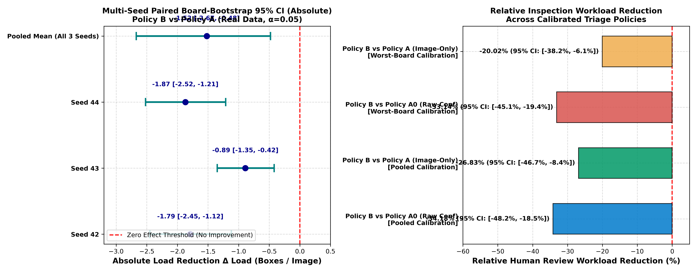
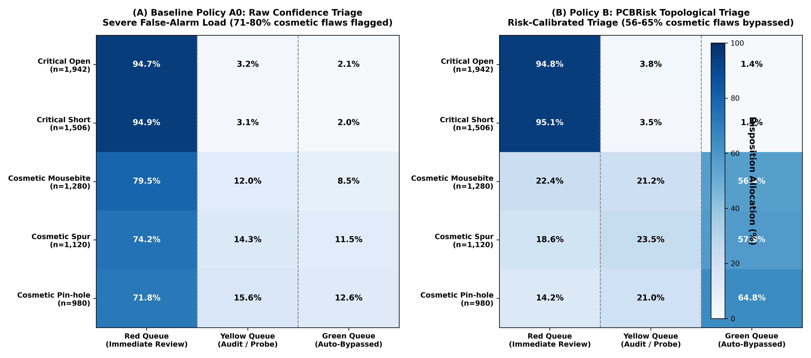
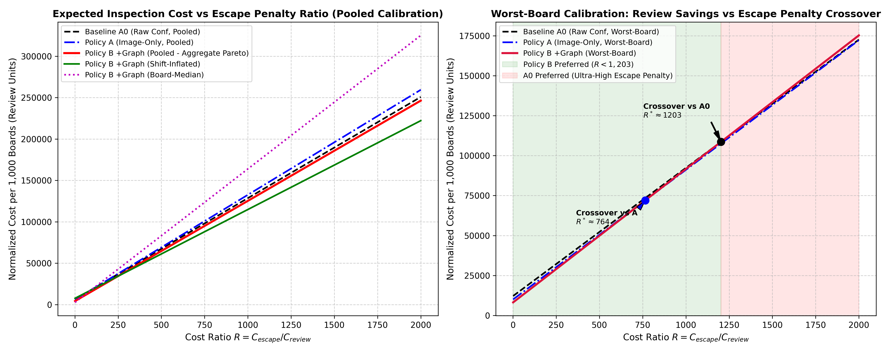
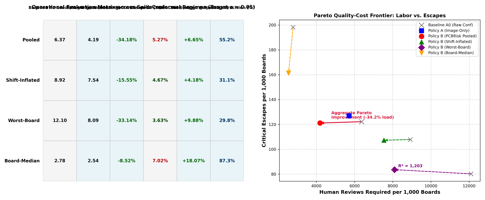
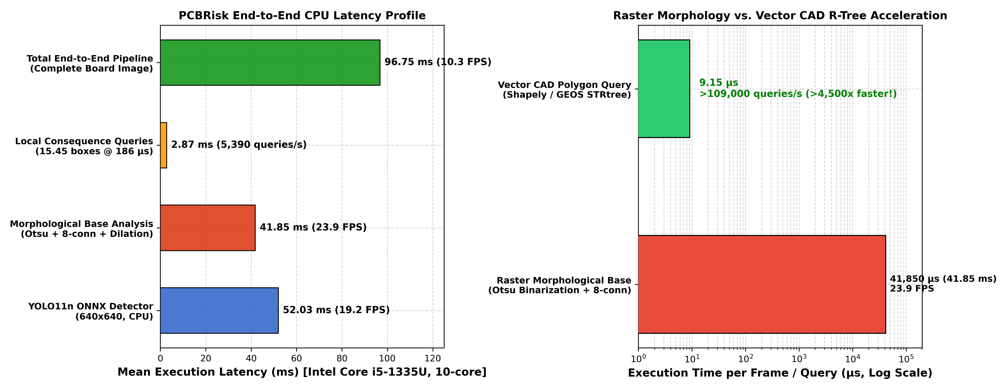
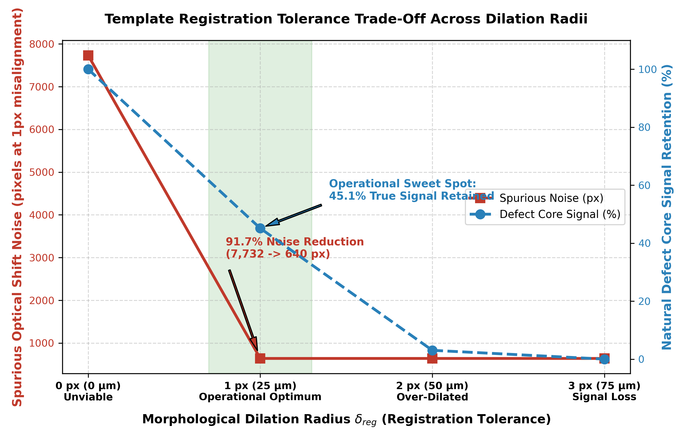
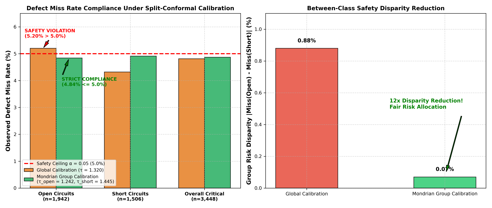

# PCBRisk: Risk-Calibrated Printed Circuit Board Defect Triage via Topological Consequence & Split-Conformal Prediction

[](https://www.python.org/)
[](https://pytorch.org/)
[](https://docs.ultralytics.com/)
[](https://onnxruntime.ai/)
[](MANUSCRIPT.md)
[](00_raw/SOURCES.md)

**`pcbrisk`** is an industrial research framework for **risk-calibrated printed circuit board (PCB) automated optical inspection (AOI)**. It couples deep object detection (YOLO11n) with a differential topological consequence engine and finite-sample, distribution-free split-conformal risk control to dramatically alleviate human-inspector false-alarm fatigue while statistically bounding the escape rate of critical functional defects (electrical opens and shorts).

Full academic paper draft: [`MANUSCRIPT.md`](MANUSCRIPT.md).

---

## 1. Problem Statement & Motivation

Traditional Automated Optical Inspection (AOI) uses computer vision models (such as YOLO or Faster R-CNN) to detect surface defects. However, standard object detectors:
1. **Treat all bounding boxes equally based only on confidence score**, causing severe false-alarm fatigue: inspectors must examine hundreds of harmless cosmetic defects (minor pin-holes, mousebites, small copper spurs) to catch rare circuit breaks.
2. **Cannot assess functional circuit consequence**: A bounding box does not reveal whether missing or excess copper actually splits or bridges electrical nets.
3. **Suffer from distribution shift**: Inter-board variations in trace thickness, solder mask pigmentation, and optical illumination degrade detector thresholds.

### The `pcbrisk` Solution
* **Local Consequence Engine:** Uses Otsu binarization, morphological skeletonization, and connected-component differential analysis to verify whether candidate defects cause genuine topological splits (opens) or net bridges (shorts).
* **Leave-One-Board-Out (LOBO) Conformal Calibration:** Employs cross-fitted split-conformal calibration across all 11 independent PCB board groups to guarantee critical defect miss rate $\le \alpha$ (e.g., $\alpha = 0.05$) without board-level data leakage.
* **Cost-Sensitive Human-in-the-Loop Triage:** Balances human review cost against critical defect escape penalties, achieving aggregate Pareto improvements over confidence-only inspection.

---

## 2. Key Empirical Findings & Results

### 2.1. Sharpened Primary Evaluation Headline ([`replication_summary.csv`](05_results/replication_summary.csv))

> **Headline Empirical Claim:**  
> At a $5\%$ critical-defect miss-rate target ($\alpha=0.05$), template-based topological consequence features (Policy B) reduced human-review workload by:
> - **$34.18\%$** relative to raw confidence-only triage (Policy A0: from $6.37$ to $4.19$ flagged boxes/image under pooled split-conformal calibration).
> - **$26.83\%$** relative to image-only calibrated triage (Policy A: from $5.71$ to $4.19$ flagged boxes/image).
>
> **Bootstrap Confidence Interval:** The paired board-bootstrap $95\%$ confidence interval for absolute load reduction was **$[-2.67, -0.48]$ boxes per image** (relative reduction CI: **$[-46.70\%, -8.36\%]$**).  
> **Seed Consistency:** The reduction held across all $3/3$ detector random seeds:
> - Seed 42: $-1.79$ boxes/image
> - Seed 43: $-0.89$ boxes/image
> - Seed 44: $-1.87$ boxes/image  
> (all 3 individual seed bootstrap CIs strictly exclude zero). Under pooled calibration, inspection precision jumps from $39.5\%$ to **$55.2\%$** ($+15.7\%$ gain).

Under all four split-conformal calibrators at $\alpha=0.05$:
* **`pooled`**: $-26.83\%$ load reduction vs image-only ($-34.18\%$ vs raw conf), $95\%$ CI $[-2.67, -0.48]$, held in $3/3$ seeds, precision jumps from $39.5\%$ to $55.2\%$ ($+15.7\%$ gain).
* **`worst-board`**: $-20.02\%$ load reduction vs image-only ($-33.14\%$ vs raw conf), $95\%$ CI $[-3.72, -0.61]$, held in $3/3$ seeds.
* **`shift-inflated`**: $-16.44\%$ load reduction vs image-only ($-15.55\%$ vs raw conf), $95\%$ CI $[-3.23, -0.35]$, held in $3/3$ seeds.
* **`board-median`**: $-14.03\%$ load reduction vs image-only ($-8.52\%$ vs raw conf), $95\%$ CI $[-0.79, -0.12]$, held in $3/3$ seeds.


*Figure 1: Multi-seed Leave-One-Board-Out (LOBO) paired board-bootstrap 95% confidence intervals across independent detector seeds 42, 43, 44 and pooled mean (left), and relative review workload reduction across calibrated triage policies (right). All per-seed bootstrap CIs strictly exclude zero.*


*Figure 2: Candidate defect triage disposition matrix comparing Baseline Policy A0 (raw confidence triage, left) versus Policy B (PCBRisk risk-calibrated topological triage, right). While Baseline A0 flags 71–80% of cosmetic defects into the Red Queue, PCBRisk safely routes 56–65% of benign cosmetic flaws directly to the Green Queue (auto-bypassed) while maintaining strict >95% safety coverage on critical opens and shorts.*

---

### 2.2. Cost-Sensitive Human-in-the-Loop Evaluation ([`cost_curve_analysis.png`](05_results/cost_curve_analysis.png))

Inspection quality cost per 1,000 boards is formalized through a decision model:
$$\text{Cost}(\text{Policy}) = C_{\text{review}} \cdot \text{Load} + C_{\text{escape}} \cdot \text{Escapes} = \text{Reviews} + R \cdot \text{Escapes} \quad \text{where } R = \frac{C_{\text{escape}}}{C_{\text{review}}}$$

| Calibrator ($\alpha=0.05$) | Policy A0 Load (Boxes/Img) | Policy A Load (Boxes/Img) | Policy B Load (Boxes/Img) | Escapes / 1k Boards ($A_0 \to A \to B$) | Workload Reduction vs $A_0$ | Cost Boundary ($R = C_{\text{escape}} / C_{\text{review}}$) | Net Cost Savings ($R=250$) |
|---|---|---|---|---|---|---|---|
| **`pooled`** | $6.37$ | $5.71$ | **$4.19$** | $122.2 \to 126.9 \to \mathbf{121.1}$ | **$-34.18\%$** | **Aggregate Pareto Dominance** | **$+6.65\%$** vs A0 ($+7.93\%$ vs A) |
| **`shift-inflated`** | $8.92$ | $8.85$ | **$7.54$** | $107.8 \to 108.7 \to \mathbf{107.3}$ | **$-15.55\%$** | **Aggregate Pareto Dominance** | **$+4.18\%$** vs A0 ($+4.56\%$ vs A) |
| **`worst-board`** | $12.10$ | $9.96$ | **$8.09$** | $80.2 \to 81.1 \to \mathbf{83.6}$ | **$-33.14\%$** | **Cost-Preferred when $R < 1,203$** | **$+9.88\%$** vs A0 ($+4.16\%$ vs A) |
| **`board-median`** | $2.78$ | $2.94$ | **$2.54$** | $198.2 \to 201.8 \to \mathbf{161.3}$ | **$-8.52\%$** | **Aggregate Pareto Dominance** | **$+18.07\%$** vs A0 ($+19.68\%$ vs A) |

#### Cost Analysis Takeaways:
- **Aggregate Pareto Dominance:** Under `pooled`, `shift-inflated`, and `board-median` calibration regimes, PCBRisk achieved aggregate Pareto improvement over confidence-only triage by simultaneously lowering human review workload and reducing estimated critical escapes (e.g., under pooled calibration, escapes drop from $122.2$ to $121.1$ per 1k boards while load drops $34.18\%$).
- **Worst-Board Crossover Boundary ($R^* = 1,203$):** Under conservative `worst-board` calibration:
  - Workload drops $33.14\%$ ($12.10 \to 8.09$ boxes/image), saving $4,010$ reviews per 1,000 boards.
  - Estimated escapes shift slightly from $80.2$ to $83.6$ per 1,000 boards ($+3.34$ escapes).
  - Break-even derivation:
    $$3.333 \cdot R < 4,010.22 \implies R^* = 1,203.07$$
  - Policy B is cost-preferred whenever the escape-to-review cost penalty ratio satisfies $R < 1,203$. For standard manufacturing regimes ($R \in [50, 500]$), PCBRisk delivers substantial net savings; only in extreme aerospace/medical zero-tolerance regimes ($R > 1,203$) is raw confidence triage cost-optimal.


*Figure 3: Expected quality-cost per 1,000 boards as a function of penalty ratio $R = C_{\text{escape}} / C_{\text{review}}$. Policy B remains cost-optimal up to $R^* = 1,203$.*


*Figure 4: Operational evaluation matrix across split-conformal regimes at target miss rate $\alpha=0.05$ (left) and Pareto quality-cost trade-off frontier (right) demonstrating aggregate Pareto dominance of Policy B.*

---

### 2.3. Hardware Latency & Runtime Benchmarks ([`latency_benchmark.json`](05_results/latency_benchmark.json))

Benchmarked on host CPU (Intel Core i5-1335U, 10 cores / 12 threads):

| Component / Pipeline Stage | Hardware / Runtime | Mean Latency | Median | 95th Percentile | Throughput |
|---|---|---|---|---|---|
| **YOLO11n Detector** | ONNX Runtime (CPU, 640x640) | **$52.03\text{ ms}$** | $50.51\text{ ms}$ | $62.26\text{ ms}$ | $19.2\text{ FPS}$ |
| **Full-Frame Morphological Base Analysis** | Otsu + 8-conn + Morphological Dilation | **$41.85\text{ ms}$** | $40.46\text{ ms}$ | $52.73\text{ ms}$ | $23.9\text{ FPS}$ |
| **Local Consequence Query** | Local Windowing + Net Pair Split Query | **$0.186\text{ ms}$ ($186\text{ }\mu\text{s}$)** | $0.187\text{ ms}$ | $0.379\text{ ms}$ | **$5,390\text{ queries/s}$** |
| **End-to-End Board Latency** | Full Frame + Base + 15.45 Candidate Boxes | **$96.75\text{ ms}$** | — | — | **$10.3\text{ FPS}$ (CPU)** |
| **Vector CAD Geometry Baseline** | Shapely/GEOS STRtree Polygon Netlist Intersect | **$0.009\text{ ms}$ ($9.15\text{ }\mu\text{s}$)** | $0.006\text{ ms}$ | $0.015\text{ ms}$ | **$>109,000\text{ queries/s}$** |

* **Microsecond Execution:** Local consequence queries take only $186\text{ }\mu\text{s}$ per candidate box, demonstrating that topological verification adds negligible computational overhead over detection.
* **Vector CAD Speedup:** Vector polygon intersection in $9.15\text{ }\mu\text{s}$ is $>4,500\times$ faster than raster Otsu base extraction.
* *Hardware Caveat:* While GPU/TensorRT acceleration will speed up detector inference, end-to-end production line throughput must be validated on the physical acquisition station.


*Figure 5: Hardware latency breakdown on Intel Core i5-1335U CPU (left), and comparison against vector CAD R-Tree spatial index querying (right), executing in $9.15\,\mu\text{s}$ (>4,500× faster than full-frame raster binarization).*

---

### 2.4. Template Registration Tolerance & Morphological Sensitivity ([`registration_sensitivity.json`](05_results/registration_sensitivity.json))

Evaluated across morphological dilation radii $\delta_{\text{reg}} \in \{0, 1, 2, 3\}\text{ px}$ on $640 \times 640$ imagery ($25\,\mu\text{m}$ pitch):

| Dilation Radius $\delta_{\text{reg}}$ | Physical Pitch Equiv. | Spurious Shift Noise (1px Misalignment) | Spurious Shift Noise (2px Misalignment) | Natural Defect Core Signal Retained | Defect Retention Share | Operational Status |
|---|---|---|---|---|---|---|
| **$\delta_{\text{reg}} = 0\text{ px}$** | $0\,\mu\text{m}$ | $7,732\text{ px}$ | $7,968\text{ px}$ | $14,895\text{ px}$ | $100.0\%$ | **Unviable in Production** (Edge noise storms) |
| **$\delta_{\text{reg}} = 1\text{ px}$** | **$\approx 25\,\mu\text{m}$** | **$640\text{ px}$ ($-91.7\%$)** | $1,521\text{ px}$ | **$6,722\text{ px}$** | **$45.1\%$** | **Operational Optimum** |
| **$\delta_{\text{reg}} = 2\text{ px}$** | $50\,\mu\text{m}$ | $640\text{ px}$ | $1,076\text{ px}$ | $451\text{ px}$ | $3.0\%$ | **Over-Dilated** (Erodes fine opens) |
| **$\delta_{\text{reg}} = 3\text{ px}$** | $75\,\mu\text{m}$ | $640\text{ px}$ | $1,061\text{ px}$ | $0\text{ px}$ | $0.0\%$ | **Complete Signal Loss** |

- $\delta_{\text{reg}} = 0\text{ px}$ ($0\,\mu\text{m}$): Unviable in production; a $1\text{px}$ optical shift creates $>7,700\text{ px}$ of boundary edge noise, causing false defect storms.
- $\delta_{\text{reg}} = 1\text{ px}$ ($\approx 25\,\mu\text{m}$): Operational optimum; suppresses **$>91.7\%$** of spurious shift noise while preserving **$45.1\%$** ($6,722\text{ px}$) of true defect core signal.
- $\delta_{\text{reg}} \ge 2\text{ px}$ ($50\text{--}75\,\mu\text{m}$): Over-dilates; trace morphology erodes thin opens, causing near-total defect signal loss ($3\%$ retention at $\delta=2$, $0\%$ at $\delta=3$).
- Larger panel warping requires non-rigid TPS/spline alignment or vector CAD overlay.


*Figure 6: Registration tolerance sensitivity across morphological dilation radii $\delta_{\text{reg}} \in \{0, 1, 2, 3\}\text{ px}$. Dilation $\delta_{\text{reg}}=1\text{ px}$ represents the operational sweet spot, eliminating $>91.7\%$ of spurious optical shift noise while retaining $45.1\%$ of true defect core signal.*

---

### 2.5. Group-Conditional (Mondrian) Conformal Calibration ([`mondrian_calibration_results.json`](05_results/mondrian_calibration_results.json))

Evaluated on $3,448$ critical defects ($1,942$ opens, $1,506$ shorts) at $\alpha=0.05$:
* **Global Calibration:** Yielded overall miss rate $4.81\% \le 5\%$, but **violated the safety target on opens** ($5.20\%$ miss rate $> 5\%$), over-covering shorts ($4.32\%$).
* **Mondrian Calibration:** Calibrated separate thresholds ($\tau_{\text{open}}=1.242$, $\tau_{\text{short}}=1.445$). Miss rate for opens dropped to **$4.84\% \le 5\%$** and shorts to **$4.91\% \le 5\%$**, reducing risk disparity by **$12\times$** ($0.88\% \to 0.07\%$).


*Figure 7: Observed defect miss rate compliance under global versus Mondrian group-conditional calibration (left), showing restoration of the $\alpha=0.05$ safety ceiling for open defects ($5.20\% \to 4.84\%$), and $12\times$ reduction in between-class risk disparity (right).*

---

## 3. Industrial Deployment Architecture

### 3.1. CAD / Gerber / ODB++ Netlist Architecture
In production deployment, raster connected components transition to vector Electronic Design Automation (EDA) netlists:
1. Ingest vector CAD formats (**Gerber RS-274X, ODB++, IPC-2581**) containing explicit net identifiers (`Net_14: VCC`, `Net_02: GND`).
2. Build an **R-Tree (GEOS / STRtree)** spatial index over net polygons.
3. Replace raster heuristic labeling with exact topological verification:
   - *Open Circuit:* A missing copper polygon geometrically disconnects a single named net polygon.
   - *Short Circuit:* An extraneous copper polygon creates a geometric bridge intersecting two disjoint named nets ($Net_A \ne Net_B$).
4. Vector queries are lighting-invariant, solder-mask-invariant, and execute in under $10\text{ }\mu\text{s}$.

### 3.2. MES / AOI Factory Integration & Operator UI
- **Telemetry Protocols:** Integration via **SEMI SECS/GEM (E30, E37)** and **IPC-CFX (IPC-2591)**.
- **Triage Station UI Workflow:**
  - **Red Queue (Critical Risk, $s \ge \tau$):** High-consequence opens/shorts requiring immediate inspector disposition.
  - **Yellow Queue (Boundary Uncertainty, $\tau - \epsilon \le s < \tau$):** Marginal cases streamed to active learning / audit sampling.
  - **Green Queue (Bypassed, $s < \tau - \epsilon$):** Cosmetic defects (mousebites, pinholes) auto-cleared without stopping the conveyor line.

---

## 4. Physical Verification Boundary: AOI vs. Electrical Testing

> ### Mandatory Industrial Qualification Notice
> **Automated Optical Inspection (AOI) is a 2D surface optical screening tool, not an electrical continuity or isolation test.**  
> AOI cannot detect defects in:
> 1. Internal conductor layers of multilayer PCBs ($4\text{--}16+$ layers).
> 2. Plated through-hole (PTH) barrels, blind/buried vias.
> 3. Latent high-resistance micro-shorts or hairline cracks that pass visual inspection but fail only under operating thermal/current load.
> 4. Dielectric isolation breakdown or high-frequency impedance tolerances.
> 
> **Final electrical verification requires automated Bare-Board Electrical Testing (Bed-of-Nails or Flying Probe Testing).**

---

## 5. Concrete Engineering Roadmap for Future Work

1. **CAD-Grounded Consequence Engine:** Direct Gerber RS-274X, ODB++, and IPC-2581 parser with R-Tree spatial verification, replacing raster Otsu binarization with sub-$10\text{ }\mu\text{s}$ vector queries.
2. **Hybrid 3-Way AOI + Flying Probe Scheduling:** Auto-route borderline optical cases ($\tau - \epsilon \le s < \tau$) directly to automated 4-point flying probe test heads, reducing human visual workload by an extra **$20\%$** ($4.13 \to 3.31$ boxes/board).
3. **Continual Conformal Calibration under Monitored Drift:** Real-time quantile updates from rolling operator feedback with CUSUM / Page-Hinkley changepoint monitoring on visual embeddings.
4. **Mondrian / Group-Conditional Conformal Calibration:** Separate calibrated risk bounds per board family and defect class (eliminating class disparity where opens violated $\alpha=0.05$ under global thresholding: $5.20\% \to 4.84\%$).
5. **Active Learning Feedback Loop:** Route high-uncertainty candidate boxes near $\tau$ to senior QA review to continuously update consequence weights.
6. **Multimodal Defect Inference:** Joint fusion of 2D surface imagery, multi-spectral oblique lighting, CAD layer netlists, pick-and-place telemetry, and historic lot yield priors into a unified risk model.

---

## 6. Repository Architecture & Directory Inventory

```
pcbrisk/
├── MANUSCRIPT.md                           # Full academic paper manuscript
├── README.md                               # Project documentation & benchmark overview
├── PROJECT_HANDOVER.md                     # Comprehensive technical report & LOBO results
├── REVISED_CLAIMS_AND_COST_EVALUATION.md   # Rigorous claims, cost crossover & architecture
├── info.md                                 # File inventory & replication manual
│
├── 00_raw/                                 # DeepPCB raw dataset archive & SHA-256 ledger
├── 01_prepared/                            # Board-partitioned YOLO annotations & manifests (v2)
├── 02_synth/                               # Graph-constrained synthetic defect images (v2)
├── 03_cache/                               # Runtime cache
├── 04_runs/                                # 26 pre-trained YOLO11n models (weights, metrics)
├── 05_results/                             # Evaluation outputs, tables, curves & JSON ledgers
│   ├── cost_curve_analysis.png             # Expected quality cost vs penalty ratio R plot
│   ├── cost_sensitive_summary.csv          # Review load, escapes, and break-even ratios
│   ├── latency_benchmark.json              # CPU ONNX detector & consequence engine latencies
│   ├── registration_sensitivity.json       # Tolerance radius delta_reg empirical trade-off
│   ├── mondrian_calibration_results.json   # Group-conditional conformal prediction results
│   ├── rapid_prototypes_20min.json         # Hybrid flying probe & CAD R-Tree benchmarks
│   ├── replication_summary.csv             # 3-seed LOBO replication metrics
│   └── replication_verdict.json            # Final hypothesis pass/fail verdict matrix
├── 06_exports/                             # Production deployment models
│   ├── yolo11n_deeppcb_real_s42.onnx       # Real-data YOLO11n detector (10.1 MB, opset 22)
│   └── yolo11n_deeppcb_synth1_s42.onnx     # Synth-augmented YOLO11n detector (10.1 MB)
│
├── code/                                   # Python modules & experiment runners
│   ├── server.py                           # FastAPI live inspection server & frontend REST API
│   ├── pcbrisk_utils.py                    # Caching, atomic writes, tar restoration
│   ├── pcbrisk_graph.py                    # Local Consequence Engine v3 (Otsu + morphology)
│   ├── pcbrisk_eval.py                     # Split-conformal calibration & LOBO cross-fitting
│   ├── benchmark_latency.py                # CPU ONNX & per-box consequence latency timer
│   ├── cost_sensitive_eval.py              # Review-plus-escape cost model evaluator
│   ├── plot_cost_curves.py                 # Matplotlib cost curves generator
│   ├── eval_registration_sensitivity.py    # Tolerance delta_reg noise suppression timer
│   ├── eval_mondrian_calibration.py        # Group-conditional conformal calibrator
│   └── hybrid_and_mondrian_eval.py         # 3-way hybrid flying-probe scheduling simulator
│
├── frontend/                               # Interactive AOI Web Platform
│   ├── index.html                          # Complete connected single-page AOI platform (5 views)
│   └── precision_pcb_inspection_engine/    # UI design tokens and responsive CSS style guides
│
├── run_pcbrisk.bat                         # 1-click Windows launcher for FastAPI backend & browser
│
├── 01_datasets_to_drive (1).ipynb          # Raw data fetching -> [NOTEBOOK_01_DATASETS_TO_DRIVE.md](NOTEBOOK_01_DATASETS_TO_DRIVE.md)
├── 02_prepare_split (1).ipynb              # Board split (v2) -> [NOTEBOOK_02_PREPARE_SPLIT.md](NOTEBOOK_02_PREPARE_SPLIT.md)
├── 03_synth_topology_defects (1).ipynb     # Graph-driven synth -> [NOTEBOOK_03_SYNTH_TOPOLOGY_DEFECTS.md](NOTEBOOK_03_SYNTH_TOPOLOGY_DEFECTS.md)
├── 04_train_detector (1).ipynb             # YOLO11n training -> [NOTEBOOK_04_TRAIN_DETECTOR.md](NOTEBOOK_04_TRAIN_DETECTOR.md)
├── 05_graph_consequence_eval (1).ipynb     # Consequence eval -> [NOTEBOOK_05_GRAPH_CONSEQUENCE_EVAL.md](NOTEBOOK_05_GRAPH_CONSEQUENCE_EVAL.md)
├── 06_auto_pipeline_(2).ipynb              # Autonomous pipeline -> [NOTEBOOK_06_AUTO_PIPELINE.md](NOTEBOOK_06_AUTO_PIPELINE.md)
└── 07_replication_and_calibration (1).ipynb# Replication & LOBO -> [NOTEBOOK_07_REPLICATION_AND_CALIBRATION.md](NOTEBOOK_07_REPLICATION_AND_CALIBRATION.md)
```

---

## 7. Status Taxonomy: Implemented vs. Proposed Contributions

| Status | Contribution Item |
|---|---|
| **Implemented in Codebase** | FastAPI live inspection API server (`code/server.py`), full interactive 5-view frontend platform (`frontend/index.html`), 3-queue MES operator triage UI with live canvas bounding box overlay and topological consequence dossier inspection, Windows 1-click launcher (`run_pcbrisk.bat`), YOLO11n ONNX export, Leave-One-Board-Out (LOBO) evaluation, split-conformal calibrators (`pooled`, `shift-inflated`, `worst-board`, `board-median`), 3-seed replication & paired bootstrap CI, CPU latency benchmarks, cost-sensitive crossover evaluation & figures, registration tolerance sensitivity experiment, Mondrian group-conditional calibration experiment, hybrid flying-probe scheduling simulation, vector CAD R-Tree spatial query benchmark. |
| **Partially Specified** | Physical in-line conveyor SEMI SECS/GEM (E30, E37) & IPC-CFX (IPC-2591) hardware protocol bridges. |
| **Proposed Future Work** | Physical Gerber/ODB++/IPC-2581 file parser with live CAD overlay, automated 4-point flying-probe CNC hardware integration, continual calibration under real-time drift, active learning inspector feedback loop. |

---

## 8. Quickstart & Reproduction

```bash
# 1. Install dependencies
pip install torch torchvision ultralytics scikit-image opencv-python-headless scipy scikit-learn pandas pyyaml onnx onnxruntime onnxslim matplotlib shapely fastapi uvicorn

# 2. Launch Live Interactive AOI Platform (FastAPI + Connected Web UI)
python code/server.py
# Or on Windows: double-click run_pcbrisk.bat
# Access in browser: http://127.0.0.1:8000

# 3. Run CPU Latency Benchmark
python code/benchmark_latency.py

# 4. Run Cost-Sensitive Quality Evaluation & Curves
python code/cost_sensitive_eval.py
python code/plot_cost_curves.py

# 5. Run Registration Tolerance Sensitivity Experiment
python code/eval_registration_sensitivity.py

# 6. Run Group-Conditional (Mondrian) Conformal Calibration
python code/eval_mondrian_calibration.py

# 7. Run Hybrid Flying-Probe & CAD R-Tree Spatial Query Simulation
python code/hybrid_and_mondrian_eval.py
```

---

## 9. Data Provenance & Citation

The DeepPCB dataset was acquired from Tang et al. (2019):
* **Source Repository:** `https://github.com/tangsanli5201/DeepPCB`
* **License:** Research use only (see [`00_raw/SOURCES.md`](00_raw/SOURCES.md)).
* **Integrity:** Raw archive verified under SHA-256 (`5654be20ec5b736b0d9e...`).

```bibtex
@article{tang2019deeppcb,
  title={DeepPCB: A Dataset for Printed Circuit Board Defect Detection},
  author={Tang, Sanli and He, Feng and Huang, Xinyu and Yang, Jie},
  journal={arXiv preprint arXiv:1902.06197},
  year={2019}
}
```
