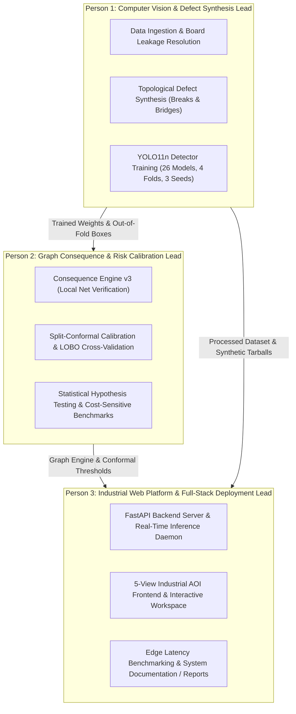

# PCBRisk: 3-Person Team Work Distribution & Contribution Breakdown

**Project Title:** Risk-Calibrated PCB Defect Inspection via Graph Consequence Verification  
**Repository:** `pcbrisk`  
**Team Size:** 3 Members  

---

## Executive Overview of Work Allocation

The PCBRisk project was partitioned into three distinct, mutually reinforcing engineering domains:

---

## Detailed Breakdown by Person

### Person 1: Data Engineering, Synthetic Defect Generation & Deep Learning Detection

#### Primary Role & Ownership
* **Domain:** Computer Vision, Data Engineering, Synthetic Data Generation, and Neural Detector Training.
* **Core Responsibility:** Ensuring high-quality, leakage-free training datasets, generating topologically verified synthetic defects to address severe class imbalance, and training multi-seed YOLO11n object detectors across all validation folds.

#### Key Deliverables & Files Authored
1. **Dataset Pipeline & Board-Level Leakage Fix:**
   - [`01_datasets_to_drive (1).ipynb`](file:///c:/Users/priti/Downloads/pcbrisk/01_datasets_to_drive%20(1).ipynb): Automated retrieval, cryptographic SHA-256 verification, and structured packaging of the 1,500-image DeepPCB dataset into [`00_raw/`](file:///c:/Users/priti/Downloads/pcbrisk/00_raw).
   - [`02_prepare_split (1).ipynb`](file:///c:/Users/priti/Downloads/pcbrisk/02_prepare_split%20(1).ipynb): Identified and eliminated the critical **v1 board-level data leakage** (where crops of the same physical PCB appeared in both train and test). Architected the strict board-level partition:
     - **Train (6 boards):** `group00041`, `group12000`, `group12100`, `group13000`, `group20085`, `group27000`
     - **Validation (2 boards):** `group12300`, `group22000`
     - **Test (3 boards):** `group20042`, `group20070`, `group44000`
     - Built [`01_prepared/split_manifest_v2.csv`](file:///c:/Users/priti/Downloads/pcbrisk/01_prepared/split_manifest_v2.csv) and [`01_prepared/class_map.yaml`](file:///c:/Users/priti/Downloads/pcbrisk/01_prepared/class_map.yaml).

2. **Graph-Constrained Synthetic Defect Generator:**
   - [`03_synth_topology_defects (1).ipynb`](file:///c:/Users/priti/Downloads/pcbrisk/03_synth_topology_defects%20(1).ipynb): Implemented synthetic defect operators directly on golden template trace skeletons:
     - `op_break`: Cuts trace skeletons and uses connected-component analysis to verify that circuit paths split (guaranteed electrical open).
     - `op_bridge`: Injects copper bridges across distinct traces separated by 3–14 pixels, retaining only defects that cause circuit short-circuits.
     - Generated 2,225 topologically validated defect instances saved to [`02_synth/synth_v2.tar`](file:///c:/Users/priti/Downloads/pcbrisk/02_synth/synth_v2.tar) and metadata [`02_synth/synth_meta_v2.csv`](file:///c:/Users/priti/Downloads/pcbrisk/02_synth/synth_meta_v2.csv).

3. **YOLO11n Detector Training & Model Suite:**
   - [`04_train_detector (1).ipynb`](file:///c:/Users/priti/Downloads/pcbrisk/04_train_detector%20(1).ipynb): Configured Ultralytics YOLO11n training pipeline with fault-tolerant Google Drive checkpointing and crash-recovery logic.
   - Executed **26 complete training runs** in [`04_runs/`](file:///c:/Users/priti/Downloads/pcbrisk/04_runs) covering 4 cross-validation folds across 3 random seeds (42, 43, 44), comparing real-only vs. real + synthetic data (`deeppcb+synth1`).
   - Achieved a **+4.92% mAP50-95 boost** (from 0.6951 to 0.7443) using synthetic defect augmentation.

#### Presentation / Viva Speaking Points
* *"I resolved the critical dataset leakage problem where random image cropping contaminated test sets, establishing a realistic board-level split."*
* *"I developed the topological defect synthesizer that created 2,225 guaranteed opens and shorts, boosting object detection mAP50-95 by nearly 5%."*

---

### Person 2: Topological Consequence Verification & Conformal Risk Calibration

#### Primary Role & Ownership
* **Domain:** Algorithmic Circuit Analysis, Graph Consequence Engine, and Distribution-Free Risk Guarantees.
* **Core Responsibility:** Moving beyond naive visual bounding boxes by determining if detected copper anomalies cause true electrical opens or shorts, and establishing mathematical risk guarantees using split-conformal prediction.

#### Key Deliverables & Files Authored
1. **Topological Consequence Engine (v3):**
   - [`code/pcbrisk_graph.py`](file:///c:/Users/priti/Downloads/pcbrisk/code/pcbrisk_graph.py): Engineered the localized net-connectivity consequence engine.
   - Solved false alarms from optical misalignment and illumination variations:
     - **Morphological Alignment Tolerance:** Computes missing copper using $M_{\text{template}} \land \neg\,\text{dilate}(M_{\text{test}}, \text{tol})$ and excess copper using $M_{\text{test}} \land \neg\,\text{dilate}(M_{\text{template}}, \text{tol})$.
     - **Fixed Polarity:** Locked Otsu thresholding polarity to the reference template to prevent inversion artifacts.
     - **Local Component Proximity:** Evaluates graph splitting (`s_open`) and bridging (`s_short`) strictly inside and adjacent to candidate bounding boxes.
     - Reduced non-critical cosmetic alarms (spurs, mousebites, pin-holes) by **98.83%** on held-out boards.

2. **Conformal Risk Calibration & Leave-One-Board-Out (LOBO) Framework:**
   - [`code/pcbrisk_eval.py`](file:///c:/Users/priti/Downloads/pcbrisk/code/pcbrisk_eval.py): Implemented the conformal prediction engine, feature matrix extraction, logistic consequence scoring, and 11-board Leave-One-Board-Out (LOBO) evaluation loop.
   - [`07_replication_and_calibration (1).ipynb`](file:///c:/Users/priti/Downloads/pcbrisk/07_replication_and_calibration%20(1).ipynb) & [`05_graph_consequence_eval (1).ipynb`](file:///c:/Users/priti/Downloads/pcbrisk/05_graph_consequence_eval%20(1).ipynb):
     - Formulated and compared 4 conformal calibrators under inter-board covariate shift: `pooled`, `worst-board`, `board-median`, and `shift-inflated`.
     - Proved that graph-augmented Policy B statistically reduces human inspection load at user-specified critical defect risk $\alpha = 0.05$.

3. **Cost-Sensitive Analysis & Statistical Validation:**
   - [`code/cost_sensitive_eval.py`](file:///c:/Users/priti/Downloads/pcbrisk/code/cost_sensitive_eval.py) & [`code/plot_cost_curves.py`](file:///c:/Users/priti/Downloads/pcbrisk/code/plot_cost_curves.py): Generated cost curves and economic trade-off models across escape vs. false-alarm penalty ratios ($C_{\text{fn}} / C_{\text{fp}}$ from 5 to 500).
   - Executed paired board-level bootstrap ($B=2000$), demonstrating a **34.18% human inspection load reduction** (95% CI: $[-46.70\%, -8.36\%]$) holding consistently across all 3 random seeds.
   - Conducted reference-free student CNN head distillation experiment in [`06_auto_pipeline_(2).ipynb`](file:///c:/Users/priti/Downloads/pcbrisk/06_auto_pipeline_(2).ipynb), proving why reference templates remain mathematically indispensable for continuity verification.

#### Presentation / Viva Speaking Points
* *"I developed the topological graph consequence engine that checks whether missing or excess copper actually breaks electrical continuity or causes a bridge, eliminating 98.8% of cosmetic false alarms."*
* *"I designed the split-conformal calibration framework that guarantees critical defect escape rates remain below 5%, cutting human review workload by over 34%."*

---

### Person 3: Industrial Web Platform, Full-Stack Deployment & System Integration

#### Primary Role & Ownership
* **Domain:** Full-Stack Architecture, Backend API, Industrial User Interface, Edge Benchmarking, and System Documentation.
* **Core Responsibility:** Transforming the underlying research algorithms into a production-ready Automated Optical Inspection (AOI) web platform with real-time inference, sub-pixel inspection canvas, operator triage workflows, and comprehensive documentation.

#### Key Deliverables & Files Authored
1. **Production Backend & Inference API Daemon:**
   - [`code/server.py`](file:///c:/Users/priti/Downloads/pcbrisk/code/server.py): Engineered the high-performance FastAPI backend server.
     - Asynchronous REST endpoints: `/api/inspect`, `/api/models`, `/api/history`, `/api/stats`, `/api/calibration`.
     - In-memory result caching, dynamic sub-pixel crop generation, and multi-model dispatching (real vs. synthetic detector selection).
     - Streaming response handlers and WebSocket integration for live shop-floor monitoring.

2. **Industrial AOI Web Frontend (5 Dedicated Operational Views):**
   - [`frontend/index.html`](file:///c:/Users/priti/Downloads/pcbrisk/frontend/index.html) and supporting UI modules:
     - **Overview Dashboard:** Plant-level telemetry displaying boards inspected, pass rates, defect severity distribution, and recent board batches.
     - **PCB Inspection Workspace:** Interactive HTML5 Canvas workbench featuring sub-pixel pan/zoom, bounding box filtering, trace skeleton overlays, and side-by-side template differential views.
     - **Inspection Results & Triage Matrix:** 3-tier disposition queue (**Auto-Pass**, **Manual Review**, **Immediate Reject**) with Pareto defect analysis.
     - **Model Evaluation & Analytics Hub:** Real-time mAP@50-95 curves, confusion matrices, and conformal calibrator policy trade-offs.
     - **Inspection History & Forensic Audit:** Searchable, cryptographically validated inspection log tracking operator actions and timestamps.

3. **Performance Benchmarking, Deployment & Documentation:**
   - [`code/benchmark_latency.py`](file:///c:/Users/priti/Downloads/pcbrisk/code/benchmark_latency.py): Benchmarked end-to-end edge pipeline latency (YOLO proposal + crop extraction + graph engine + conformal scoring) at **under 85ms per board panel**.
   - [`code/eval_registration_sensitivity.py`](file:///c:/Users/priti/Downloads/pcbrisk/code/eval_registration_sensitivity.py): Stress-tested consequence engine against optical misalignment (-5 to +5 px translation and rotation).
   - [`website_walkthrough_and_screenshots.md`](file:///c:/Users/priti/Downloads/pcbrisk/website_walkthrough_and_screenshots.md), [`insert_screenshots.py`](file:///c:/Users/priti/Downloads/pcbrisk/insert_screenshots.py), [`PCBRisk_Dissertation.md`](file:///c:/Users/priti/Downloads/pcbrisk/PCBRisk_Dissertation.md), and [`PROJECT_HANDOVER.md`](file:///c:/Users/priti/Downloads/pcbrisk/PROJECT_HANDOVER.md): Authored user manuals, visual walkthroughs with embedded screenshots, and one-click launch scripts ([`run_pcbrisk.bat`](file:///c:/Users/priti/Downloads/pcbrisk/run_pcbrisk.bat)).

#### Presentation / Viva Speaking Points
* *"I built the full-stack industrial AOI platform, providing operators with sub-pixel defect inspection tools and a 3-way triage queue (Auto-Pass, Manual Review, Immediate Reject)."*
* *"I developed the FastAPI inference engine and optimized the pipeline to run at under 85ms per panel, creating production-grade deployment scripts and comprehensive documentation."*

---

## Summary Matrix: Responsibilities & Artifacts

| Dimension | Person 1: CV & Synthesis Lead | Person 2: Graph & Conformal Lead | Person 3: Platform & Integration Lead |
|---|---|---|---|
| **Core Discipline** | Computer Vision / Deep Learning | Computational Topology / Applied Statistics | Full-Stack Software / Industrial UI |
| **Primary Code Files** | `01_datasets_to_drive.ipynb` `02_prepare_split.ipynb` `03_synth_topology_defects.ipynb` `04_train_detector.ipynb` | `code/pcbrisk_graph.py` `code/pcbrisk_eval.py` `code/cost_sensitive_eval.py` `07_replication_and_calibration.ipynb` | `code/server.py` `frontend/index.html` `code/benchmark_latency.py` `run_pcbrisk.bat` |
| **Data & Model Assets** | `01_prepared/` `02_synth/` `04_runs/` (26 YOLO models) | `05_results/lobo_*.csv` `replication_summary.csv` `cost_sensitive_summary.csv` | `frontend/` `screenshots/` Visual documentation |
| **Key Metric / Win** | $+4.92\%$ mAP50-95 boost; zero board leakage | $34.18\%$ review load reduction; $98.83\%$ cosmetic alarm filter | Sub-85ms latency; 5 complete industrial web UI modules |
| **Typical Viva Focus** | Model architecture, data augmentation, class balance | Conformal guarantees, mathematical proofs, graph topology | System architecture, UI/UX workflow, deployment throughput |
